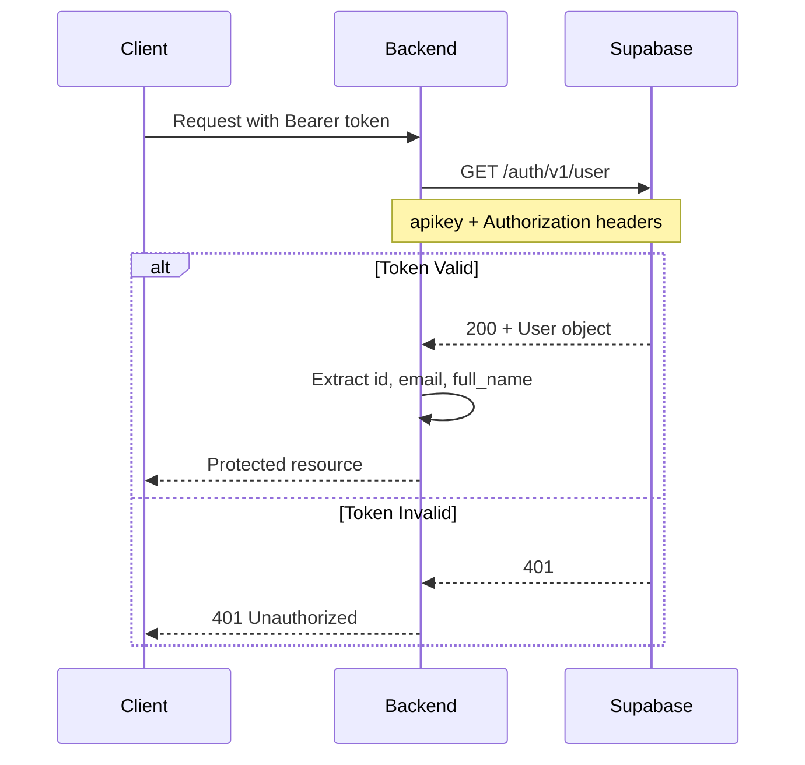

# CareerPilot API Contract

> **Single source of truth for all API endpoints, request/response schemas, validations, and integration patterns.**

---

## Table of Contents

1. [API Overview](#api-overview)
2. [Authentication](#authentication)
3. [Existing Endpoints](#existing-endpoints)
4. [New Endpoints (MVP)](#new-endpoints-mvp)
5. [Request/Response Schemas](#requestresponse-schemas)
6. [Error Handling](#error-handling)
7. [Integration Patterns](#integration-patterns)
8. [Voice Integration APIs](#voice-integration-apis)

---

## API Overview

### Base URLs

| Environment | URL |
|-------------|-----|
| Development | `http://localhost:8000` |
| Production | `https://careerpilot-5tiz.onrender.com` |

### API Versioning

Currently unversioned. All endpoints are prefixed with `/api/` except `/health`.

### Content Type

All requests and responses use `application/json` unless otherwise specified.

### Common Headers

| Header | Required | Description |
|--------|----------|-------------|
| `Authorization` | Yes (protected routes) | `Bearer <supabase_access_token>` |
| `Content-Type` | Yes (POST/PATCH) | `application/json` |

---

## Authentication

### Authentication Flow



### Token Verification

The backend verifies tokens by calling Supabase's `/auth/v1/user` endpoint. It does **not** decode JWT claims locally.

**Verified User Object:**
```python
@dataclass(frozen=True)
class AuthenticatedUser:
    id: str           # UUID from Supabase
    email: str
    full_name: str | None
    access_token: str # Original token for downstream calls
    raw_user: dict    # Full Supabase user response
```

### Protected vs Public Routes

| Route | Protection |
|-------|------------|
| `GET /health` | Public |
| `GET /` | Public |
| `GET /api/*` | Protected (requires valid token) |
| `POST /api/*` | Protected |
| `PATCH /api/*` | Protected |

---

## Existing Endpoints

### Health Check

#### `GET /health`

**Purpose:** Service health verification.

**Authentication:** None

**Response:**
```json
{
  "status": "ok",
  "service": "careerpilot-backend"
}
```

---

### User Identity

#### `GET /api/me`

**Purpose:** Get authenticated user's identity.

**Authentication:** Required

**Response Schema:** `MeResponse`
```json
{
  "id": "550e8400-e29b-41d4-a716-446655440000",
  "email": "student@example.com",
  "full_name": "John Doe"
}
```

---

### Profiles

#### `GET /api/me/profile`

**Purpose:** Get authenticated user's profile.

**Authentication:** Required

**Response Schema:** `ProfileResponse`
```json
{
  "id": "550e8400-e29b-41d4-a716-446655440000",
  "full_name": "John Doe",
  "college": "GNDEC Ludhiana",
  "branch": "Computer Science",
  "graduation_year": 2025,
  "cgpa": 8.5,
  "location": "Ludhiana, Punjab",
  "skills": ["Python", "React", "SQL"],
  "career_interests": ["Backend Development", "Data Engineering"],
  "created_at": "2024-01-15T10:30:00Z",
  "updated_at": "2024-06-20T14:45:00Z"
}
```

**Error Responses:**
- `401`: Unauthorized
- `404`: Profile not found (should auto-create on signup)

---

#### `PATCH /api/me/profile`

**Purpose:** Update authenticated user's profile.

**Authentication:** Required

**Request Schema:** `ProfileUpdate`
```json
{
  "full_name": "John Doe",
  "college": "GNDEC Ludhiana",
  "branch": "Computer Science",
  "graduation_year": 2025,
  "cgpa": 8.75,
  "location": "Ludhiana, Punjab",
  "skills": ["Python", "React", "SQL", "FastAPI"],
  "career_interests": ["Backend Development"]
}
```

All fields are optional. Only provided fields are updated.

**Validations:**
- `graduation_year`: 1900-2100
- `cgpa`: 0.00-10.00
- Unknown fields: Rejected with 422

**Response:** Updated `ProfileResponse`

**Error Responses:**
- `400`: Empty body
- `401`: Unauthorized
- `422`: Validation error

---

### Recruiters (Career Intelligence)

#### `GET /api/recruiters`

**Purpose:** List recruiters with optional filtering.

**Authentication:** Required

**Query Parameters:**
| Parameter | Type | Default | Description |
|-----------|------|---------|-------------|
| `search` | string | - | Search by name (case-insensitive) |
| `verification_status` | string | - | Filter by status |
| `limit` | integer | 20 | Results per page (1-100) |
| `offset` | integer | 0 | Pagination offset |

**Response:**
```json
[
  {
    "id": "22222222-2222-2222-2222-222222222222",
    "name": "Tata Consultancy Services",
    "description": null,
    "website_url": "https://www.tcs.com",
    "logo_url": null,
    "hiring_status": null,
    "data_source": "seed",
    "source_url": null,
    "verification_status": "verified",
    "created_at": "2024-01-01T00:00:00Z",
    "updated_at": "2024-01-01T00:00:00Z"
  }
]
```

---

#### `GET /api/recruiters/{recruiter_id}`

**Purpose:** Get single recruiter by ID.

**Authentication:** Required

**Path Parameters:**
- `recruiter_id`: UUID

**Response:** Single `RecruiterResponse`

**Error Responses:**
- `401`: Unauthorized
- `404`: Recruiter not found

---

### Roles

#### `GET /api/roles`

**Purpose:** List job roles with filtering.

**Authentication:** Required

**Query Parameters:**
| Parameter | Type | Description |
|-----------|------|-------------|
| `recruiter_id` | UUID | Filter by company |
| `search` | string | Search by title |
| `job_type` | string | `internship`, `full-time`, `other` |
| `limit` | integer | Results per page (1-100) |
| `offset` | integer | Pagination offset |

**Response:** List of `RoleResponse`

---

#### `GET /api/roles/{role_id}`

**Purpose:** Get single role with recruiter details.

**Authentication:** Required

**Response:** `RoleResponse` with nested `recruiter`
```json
{
  "id": "...",
  "recruiter_id": "...",
  "title": "Software Engineer Intern",
  "job_type": "internship",
  "description": "...",
  "minimum_cgpa": 7.0,
  "eligible_branches": ["CS", "IT", "ECE"],
  "eligible_graduation_years": [2025, 2026],
  "required_skills": ["Python", "SQL"],
  "preferred_skills": ["FastAPI", "React"],
  "location": "Bangalore",
  "application_url": "https://...",
  "source_url": null,
  "verification_status": "verified",
  "created_at": "...",
  "updated_at": "...",
  "recruiter": {
    "id": "...",
    "name": "TCS",
    ...
  }
}
```

---

#### `GET /api/roles/{role_id}/interview-experiences`

**Purpose:** Get interview experiences for a role with nested questions.

**Authentication:** Required

**Response:**
```json
[
  {
    "id": "...",
    "recruiter_id": "...",
    "role_id": "...",
    "title": "TCS NQT Experience 2024",
    "interview_year": 2024,
    "round_name": "Technical Round 1",
    "experience_text": "The interview started with...",
    "source_type": "student_report",
    "source_name": "Anonymous Student",
    "source_url": null,
    "verification_status": "verified",
    "created_at": "...",
    "questions": [
      {
        "id": "...",
        "experience_id": "...",
        "question_text": "Explain the difference between...",
        "topic": "DBMS",
        "difficulty": "Medium",
        "question_type": "Conceptual",
        "created_at": "..."
      }
    ]
  }
]
```

---

## New Endpoints (MVP)

### Interview Lifecycle

#### `POST /api/interviews`

**Purpose:** Create a new interview session.

**Authentication:** Required

**Request Schema:** `InterviewCreate`
```json
{
  "company_id": "22222222-2222-2222-2222-222222222222",
  "role": "Software Engineer Intern",
  "round": "Technical",
  "duration_minutes": 30,
  "job_description": "Optional JD text...",
  "resume_url": "optional/path/to/resume.pdf"
}
```

**Validations:**
- `company_id`: Optional, must exist if provided
- `role`: Optional string
- `round`: Optional string
- `duration_minutes`: Required, 10-60

**Response:** `InterviewResponse`
```json
{
  "id": "interview-uuid",
  "candidate_id": "user-uuid",
  "company_id": "company-uuid",
  "role": "Software Engineer Intern",
  "round": "Technical",
  "duration_minutes": 30,
  "status": "planned",
  "job_description": "...",
  "resume_url": null,
  "started_at": null,
  "ended_at": null,
  "created_at": "2024-06-20T10:00:00Z",
  "updated_at": "2024-06-20T10:00:00Z"
}
```

**Error Responses:**
- `401`: Unauthorized
- `422`: Validation error

---

#### `GET /api/interviews`

**Purpose:** List user's interviews.

**Authentication:** Required

**Query Parameters:**
| Parameter | Type | Description |
|-----------|------|-------------|
| `status` | string | Filter by status |
| `limit` | integer | Results per page (1-50, default 20) |
| `offset` | integer | Pagination offset |

**Response:** List of `InterviewResponse`

---

#### `GET /api/interviews/{interview_id}`

**Purpose:** Get interview details with current turn.

**Authentication:** Required

**Response:** `InterviewDetailResponse`
```json
{
  "id": "interview-uuid",
  "candidate_id": "user-uuid",
  "company_id": "company-uuid",
  "company": {
    "id": "...",
    "name": "TCS"
  },
  "role": "Software Engineer Intern",
  "round": "Technical",
  "duration_minutes": 30,
  "status": "active",
  "job_description": "...",
  "resume_url": null,
  "started_at": "2024-06-20T10:05:00Z",
  "ended_at": null,
  "created_at": "2024-06-20T10:00:00Z",
  "updated_at": "2024-06-20T10:05:00Z",
  "current_turn": {
    "id": "turn-uuid",
    "sequence_num": 1,
    "question_text": "What is a database index?",
    "is_follow_up": false,
    "asked_at": "2024-06-20T10:05:30Z"
  },
  "total_turns": 1,
  "total_main_questions": 1,
  "total_follow_ups": 0
}
```

**Error Responses:**
- `401`: Unauthorized
- `403`: Interview belongs to another user
- `404`: Interview not found

---

#### `POST /api/interviews/{interview_id}/start`

**Purpose:** Start an interview (triggers planning and first question).

**Authentication:** Required

**Request:** Empty body

**Process:**
1. Validate interview exists and belongs to user
2. Validate status is `planned`
3. Call Gemini Planner to generate interview plan
4. Validate plan question IDs against question bank
5. Select first question
6. Attach rubric snapshot to turn
7. Update interview status to `active`
8. Return first turn with TTS audio URL

**Response:** `InterviewStartResponse`
```json
{
  "interview_id": "interview-uuid",
  "status": "active",
  "started_at": "2024-06-20T10:05:00Z",
  "first_turn": {
    "id": "turn-uuid",
    "sequence_num": 1,
    "question_text": "What is a database index and why is it useful?",
    "is_follow_up": false,
    "asked_at": "2024-06-20T10:05:30Z"
  },
  "tts_audio_url": "/api/interviews/{id}/turns/{turn_id}/audio"
}
```

**Error Responses:**
- `401`: Unauthorized
- `403`: Interview belongs to another user
- `404`: Interview not found
- `409`: Interview already started (not in `planned` status)
- `503`: AI service unavailable

---

#### `GET /api/interviews/{interview_id}/turns/{turn_id}`

**Purpose:** Get details of a specific turn.

**Authentication:** Required

**Response:** `TurnDetailResponse`
```json
{
  "id": "turn-uuid",
  "interview_id": "interview-uuid",
  "sequence_num": 1,
  "question_id": "question-bank-uuid",
  "question_text": "What is a database index?",
  "is_follow_up": false,
  "parent_turn_id": null,
  "target_criterion_id": null,
  "asked_at": "2024-06-20T10:05:30Z",
  "answer": {
    "id": "answer-uuid",
    "transcript_text": "An index is a data structure...",
    "audio_duration_seconds": 45,
    "submitted_at": "2024-06-20T10:06:15Z"
  },
  "evaluation": {
    "id": "eval-uuid",
    "overall_score": 0.75,
    "criterion_results": [
      {
        "criterion_id": "index_purpose",
        "status": "demonstrated",
        "score": 4,
        "evidence_quote": "An index is a data structure that helps locate records faster"
      },
      {
        "criterion_id": "write_overhead",
        "status": "not_demonstrated",
        "score": null,
        "evidence_quote": null
      }
    ]
  }
}
```

---

#### `POST /api/interviews/{interview_id}/turns/{turn_id}/answer`

**Purpose:** Submit answer transcript for evaluation.

**Authentication:** Required

**Request Schema:** `AnswerSubmit`
```json
{
  "transcript_text": "An index is a data structure that helps the database locate records faster. It works like a book index...",
  "audio_duration_seconds": 45
}
```

**Validations:**
- `transcript_text`: Required, non-empty
- `audio_duration_seconds`: Optional positive integer
- Turn must not already have an answer (idempotency check)

**Process:**
1. Validate interview and turn ownership
2. Validate turn has no existing answer
3. Persist answer
4. Retrieve rubric snapshot from turn
5. Call Gemini Evaluator
6. Validate evaluation response (all criteria present, scores in range)
7. Persist evaluation and criterion results
8. Run Adaptive Controller to determine next action
9. If `probe`: Generate follow-up, create next turn
10. If `select_question`: Select next main question, create next turn
11. If `finish`: Finalize interview
12. Update skill evidence (for main questions only)
13. Return evaluation result and next action

**Response:** `AnswerResponse`
```json
{
  "answer_id": "answer-uuid",
  "evaluation": {
    "id": "eval-uuid",
    "overall_score": 0.75,
    "criterion_results": [
      {
        "criterion_id": "index_purpose",
        "status": "demonstrated",
        "score": 4,
        "evidence_quote": "An index is a data structure..."
      },
      {
        "criterion_id": "write_overhead",
        "status": "not_demonstrated",
        "score": null,
        "evidence_quote": null
      }
    ]
  },
  "next_action": "probe",
  "next_turn": {
    "id": "next-turn-uuid",
    "sequence_num": 2,
    "question_text": "How can maintaining multiple indexes affect database write performance?",
    "is_follow_up": true,
    "parent_turn_id": "turn-uuid",
    "target_criterion_id": "write_overhead",
    "asked_at": "2024-06-20T10:06:30Z"
  },
  "tts_audio_url": "/api/interviews/{id}/turns/{next_turn_id}/audio"
}
```

**Next Action Values:**
| Action | Meaning | Next Turn |
|--------|---------|-----------|
| `probe` | Follow-up question generated | Yes, `is_follow_up: true` |
| `select_question` | New main question selected | Yes, `is_follow_up: false` |
| `clarify` | Transcript unclear, re-ask | Same turn |
| `finish` | Interview complete | No |

**Error Responses:**
- `401`: Unauthorized
- `403`: Interview belongs to another user
- `404`: Interview or turn not found
- `409`: Answer already submitted for this turn
- `422`: Validation error
- `503`: AI service unavailable

---

#### `GET /api/interviews/{interview_id}/turns/{turn_id}/audio`

**Purpose:** Stream TTS audio for a question.

**Authentication:** Required

**Response:** Audio stream
- Content-Type: `audio/mpeg` (or format from TTS PoC)
- Transfer-Encoding: `chunked`

**Error Responses:**
- `401`: Unauthorized
- `403`: Interview belongs to another user
- `404`: Turn not found
- `503`: TTS service unavailable

---

#### `POST /api/interviews/{interview_id}/finish`

**Purpose:** Manually end an interview and generate report.

**Authentication:** Required

**Request:** Empty body

**Process:**
1. Validate interview ownership
2. Validate status is `active` or `paused`
3. Update status to `finalizing`
4. Aggregate all evaluations
5. Update final skill evidence
6. Call Gemini Report Narrator
7. Persist report
8. Update status to `completed`
9. Return report

**Response:** `InterviewFinishResponse`
```json
{
  "interview_id": "interview-uuid",
  "status": "completed",
  "ended_at": "2024-06-20T10:30:00Z",
  "report": {
    "id": "report-uuid",
    "overall_summary": "You demonstrated solid foundational knowledge in DBMS...",
    "overall_score": 0.72,
    "topic_results": {
      "DBMS": {
        "questions_asked": 2,
        "average_score": 0.75,
        "demonstrated_criteria": ["index_purpose", "normalization"],
        "missing_criteria": ["write_overhead"]
      }
    },
    "strengths": [
      "Clear explanation of core concepts",
      "Good use of examples"
    ],
    "weaknesses": [
      "Incomplete coverage of performance trade-offs",
      "Missing practical optimization scenarios"
    ],
    "recommendations": [
      "Practice explaining index write overhead",
      "Study B-tree vs hash index comparisons"
    ],
    "generated_at": "2024-06-20T10:30:30Z"
  }
}
```

**Error Responses:**
- `401`: Unauthorized
- `403`: Interview belongs to another user
- `404`: Interview not found
- `409`: Interview not in active/paused status
- `503`: AI service unavailable

---

#### `GET /api/interviews/{interview_id}/report`

**Purpose:** Get interview report (if completed).

**Authentication:** Required

**Response:** `InterviewReportResponse`

**Error Responses:**
- `401`: Unauthorized
- `403`: Interview belongs to another user
- `404`: Interview or report not found
- `409`: Interview not yet completed

---

### Skills

#### `GET /api/skills`

**Purpose:** List all skills in the taxonomy.

**Authentication:** Required

**Response:**
```json
[
  {
    "id": "skill-uuid",
    "name": "DBMS",
    "topic_area": "Core CS",
    "description": "Database management systems concepts"
  }
]
```

---

#### `GET /api/me/skill-states`

**Purpose:** Get candidate's skill progress.

**Authentication:** Required

**Response:**
```json
[
  {
    "skill_id": "skill-uuid",
    "skill_name": "DBMS",
    "current_difficulty": 3,
    "main_question_attempts": 5,
    "demonstrated_count": 3,
    "not_demonstrated_count": 2,
    "last_updated": "2024-06-20T10:30:00Z"
  }
]
```

---

### Voice Integration

#### `GET /api/stt/token`

**Purpose:** Get short-lived ElevenLabs STT token for browser WebSocket.

**Authentication:** Required

**Response:**
```json
{
  "token": "xi-...",
  "expires_at": "2024-06-20T10:35:00Z",
  "websocket_url": "wss://api.elevenlabs.io/v1/speech-to-text/..."
}
```

**Note:** Token is short-lived (5 minutes). Client should request a new token before expiration.

**Error Responses:**
- `401`: Unauthorized
- `503`: ElevenLabs service unavailable

---

## Request/Response Schemas

### Pydantic Models (Backend)

```python
# ============ Existing Schemas ============

class ProfileResponse(BaseModel):
    id: UUID
    full_name: str | None
    college: str | None
    branch: str | None
    graduation_year: int | None
    cgpa: float | None
    location: str | None
    skills: list[str]
    career_interests: list[str]
    created_at: datetime
    updated_at: datetime

    class Config:
        extra = "ignore"


class ProfileUpdate(BaseModel):
    full_name: str | None = None
    college: str | None = None
    branch: str | None = None
    graduation_year: int | None = None
    cgpa: float | None = None
    location: str | None = None
    skills: list[str] | None = None
    career_interests: list[str] | None = None

    @field_validator("graduation_year")
    def validate_graduation_year(cls, v):
        if v is not None and not (1900 <= v <= 2100):
            raise ValueError("graduation_year must be between 1900 and 2100")
        return v

    @field_validator("cgpa")
    def validate_cgpa(cls, v):
        if v is not None and not (0 <= v <= 10):
            raise ValueError("cgpa must be between 0 and 10")
        return v

    class Config:
        extra = "forbid"


# ============ New Interview Schemas ============

class InterviewCreate(BaseModel):
    company_id: UUID | None = None
    role: str | None = None
    round: str | None = None
    duration_minutes: int = Field(..., ge=10, le=60)
    job_description: str | None = None
    resume_url: str | None = None


class InterviewResponse(BaseModel):
    id: UUID
    candidate_id: UUID
    company_id: UUID | None
    role: str | None
    round: str | None
    duration_minutes: int
    status: Literal["planned", "active", "paused", "finalizing", "completed", "abandoned"]
    job_description: str | None
    resume_url: str | None
    started_at: datetime | None
    ended_at: datetime | None
    created_at: datetime
    updated_at: datetime


class TurnResponse(BaseModel):
    id: UUID
    sequence_num: int
    question_text: str
    is_follow_up: bool
    parent_turn_id: UUID | None
    target_criterion_id: str | None
    asked_at: datetime


class CriterionResult(BaseModel):
    criterion_id: str
    status: Literal["demonstrated", "partially_demonstrated", "not_demonstrated", "contradicted", "uncertain"]
    score: int | None = Field(None, ge=0, le=4)
    evidence_quote: str | None
    explanation: str | None


class EvaluationResponse(BaseModel):
    id: UUID
    overall_score: float | None
    criterion_results: list[CriterionResult]


class AnswerSubmit(BaseModel):
    transcript_text: str = Field(..., min_length=1)
    audio_duration_seconds: int | None = Field(None, ge=0)


class AnswerResponse(BaseModel):
    answer_id: UUID
    evaluation: EvaluationResponse
    next_action: Literal["probe", "select_question", "clarify", "finish"]
    next_turn: TurnResponse | None
    tts_audio_url: str | None


class TopicResult(BaseModel):
    questions_asked: int
    average_score: float | None
    demonstrated_criteria: list[str]
    missing_criteria: list[str]


class InterviewReportResponse(BaseModel):
    id: UUID
    interview_id: UUID
    overall_summary: str
    overall_score: float | None
    topic_results: dict[str, TopicResult]
    strengths: list[str]
    weaknesses: list[str]
    recommendations: list[str]
    generated_at: datetime


class SkillStateResponse(BaseModel):
    skill_id: UUID
    skill_name: str
    current_difficulty: int
    main_question_attempts: int
    demonstrated_count: int
    not_demonstrated_count: int
    last_updated: datetime


class STTTokenResponse(BaseModel):
    token: str
    expires_at: datetime
    websocket_url: str
```

---

## Error Handling

### Standard Error Response

```json
{
  "detail": "Error message describing what went wrong"
}
```

### HTTP Status Codes

| Code | Meaning | When Used |
|------|---------|-----------|
| 200 | OK | Successful GET, PATCH |
| 201 | Created | Successful POST creating resource |
| 400 | Bad Request | Empty body, malformed JSON |
| 401 | Unauthorized | Missing or invalid auth token |
| 403 | Forbidden | Resource belongs to another user |
| 404 | Not Found | Resource doesn't exist |
| 409 | Conflict | State conflict (already started, already answered) |
| 422 | Unprocessable Entity | Validation error |
| 500 | Internal Server Error | Unexpected server error |
| 503 | Service Unavailable | External service (Supabase, Gemini, ElevenLabs) unavailable |

### Validation Error Format (422)

```json
{
  "detail": [
    {
      "loc": ["body", "cgpa"],
      "msg": "cgpa must be between 0 and 10",
      "type": "value_error"
    }
  ]
}
```

---

## Integration Patterns

### Frontend API Client

```javascript
// services/api.js (existing pattern)
const apiBaseUrl = import.meta.env.VITE_API_URL || '';

export async function apiRequest(path, { accessToken, method = 'GET', body, signal } = {}) {
  const headers = {
    'Content-Type': 'application/json',
  };
  
  if (accessToken) {
    headers['Authorization'] = `Bearer ${accessToken}`;
  }
  
  const response = await fetch(`${apiBaseUrl}${path}`, {
    method,
    headers,
    body: body ? JSON.stringify(body) : undefined,
    signal,
  });
  
  if (!response.ok) {
    const error = new ApiError(`API error: ${response.status}`);
    error.status = response.status;
    try {
      error.data = await response.json();
    } catch {}
    throw error;
  }
  
  return response.json();
}
```

### Interview Flow Integration

```javascript
// Typical interview flow
async function conductInterview(session, interviewConfig) {
  // 1. Create interview
  const interview = await apiRequest('/api/interviews', {
    accessToken: session.access_token,
    method: 'POST',
    body: interviewConfig,
  });
  
  // 2. Navigate to interview room
  navigate(`/interview/${interview.id}`);
  
  // 3. Start interview (in InterviewRoom component)
  const { first_turn, tts_audio_url } = await apiRequest(
    `/api/interviews/${interview.id}/start`,
    { accessToken: session.access_token, method: 'POST' }
  );
  
  // 4. Play TTS audio via Simli avatar
  await playTTSAudio(tts_audio_url);
  
  // 5. Get STT token for speech recognition
  const { token, websocket_url } = await apiRequest('/api/stt/token', {
    accessToken: session.access_token,
  });
  
  // 6. Connect to ElevenLabs STT
  const stt = new ElevenLabsSTT(websocket_url, token);
  
  // 7. Capture answer and submit
  const transcript = await stt.captureAnswer();
  const { evaluation, next_action, next_turn } = await apiRequest(
    `/api/interviews/${interview.id}/turns/${currentTurn.id}/answer`,
    {
      accessToken: session.access_token,
      method: 'POST',
      body: { transcript_text: transcript },
    }
  );
  
  // 8. Handle next action
  if (next_action === 'finish') {
    navigate(`/interview/${interview.id}/report`);
  } else {
    // Play next question and repeat
    await playTTSAudio(next_turn.tts_audio_url);
  }
}
```

---

## Voice Integration APIs

### ElevenLabs STT (Browser-Side)

**Flow:**
1. Frontend requests token from `GET /api/stt/token`
2. Frontend connects WebSocket to ElevenLabs
3. Browser streams microphone audio
4. ElevenLabs returns partial and final transcripts
5. Frontend displays partials, submits final to backend

**WebSocket Protocol:**
```javascript
// Connect with token
const ws = new WebSocket(`${websocket_url}?token=${token}`);

// Send audio chunks
ws.send(audioChunk); // ArrayBuffer

// Receive transcripts
ws.onmessage = (event) => {
  const data = JSON.parse(event.data);
  if (data.type === 'partial') {
    displayPartialTranscript(data.text);
  } else if (data.type === 'final') {
    submitFinalTranscript(data.text);
  }
};
```

### ElevenLabs TTS (Server-Side)

**Endpoint:** `GET /api/interviews/{id}/turns/{turn_id}/audio`

**Backend Implementation:**
```python
@router.get("/interviews/{interview_id}/turns/{turn_id}/audio")
async def get_turn_audio(
    interview_id: UUID,
    turn_id: UUID,
    current_user: AuthenticatedUser = Depends(get_current_user),
    settings: Settings = Depends(get_settings),
):
    # Verify ownership
    turn = await get_turn_with_ownership_check(interview_id, turn_id, current_user.id)
    
    # Generate TTS
    audio_stream = await elevenlabs_tts.generate(
        text=turn.question_text,
        voice_id=settings.elevenlabs_voice_id,
    )
    
    # Stream response
    return StreamingResponse(
        audio_stream,
        media_type="audio/mpeg",
        headers={"Transfer-Encoding": "chunked"}
    )
```

### Simli Avatar Integration

**Frontend Pattern:**
```javascript
// Initialize Simli with audio
const simli = new SimliClient({
  apiKey: null, // Server-side only
  sessionId: await getSimliSession(),
});

// Feed TTS audio to Simli
async function playTTSAudio(audioUrl) {
  const response = await fetch(audioUrl, {
    headers: { Authorization: `Bearer ${accessToken}` },
  });
  
  const reader = response.body.getReader();
  
  while (true) {
    const { done, value } = await reader.read();
    if (done) break;
    
    // Buffer and frame audio per Simli's contract
    simli.feedAudio(value);
  }
}
```

---

## API Summary Table

| Method | Endpoint | Purpose | Status |
|--------|----------|---------|--------|
| GET | `/health` | Health check | ✅ Existing |
| GET | `/` | Service info | ✅ Existing |
| GET | `/api/me` | User identity | ✅ Existing |
| GET | `/api/me/profile` | Get profile | ✅ Existing |
| PATCH | `/api/me/profile` | Update profile | ✅ Existing |
| GET | `/api/recruiters` | List recruiters | ✅ Existing |
| GET | `/api/recruiters/{id}` | Get recruiter | ✅ Existing |
| GET | `/api/roles` | List roles | ✅ Existing |
| GET | `/api/roles/{id}` | Get role | ✅ Existing |
| GET | `/api/roles/{id}/interview-experiences` | Get experiences | ✅ Existing |
| GET | `/api/skills` | List skills | ❌ New |
| GET | `/api/me/skill-states` | Get skill progress | ❌ New |
| POST | `/api/interviews` | Create interview | ❌ New |
| GET | `/api/interviews` | List interviews | ❌ New |
| GET | `/api/interviews/{id}` | Get interview | ❌ New |
| POST | `/api/interviews/{id}/start` | Start interview | ❌ New |
| GET | `/api/interviews/{id}/turns/{turn_id}` | Get turn | ❌ New |
| POST | `/api/interviews/{id}/turns/{turn_id}/answer` | Submit answer | ❌ New |
| GET | `/api/interviews/{id}/turns/{turn_id}/audio` | Stream TTS | ❌ New |
| POST | `/api/interviews/{id}/finish` | End interview | ❌ New |
| GET | `/api/interviews/{id}/report` | Get report | ❌ New |
| GET | `/api/stt/token` | Get STT token | ❌ New |
