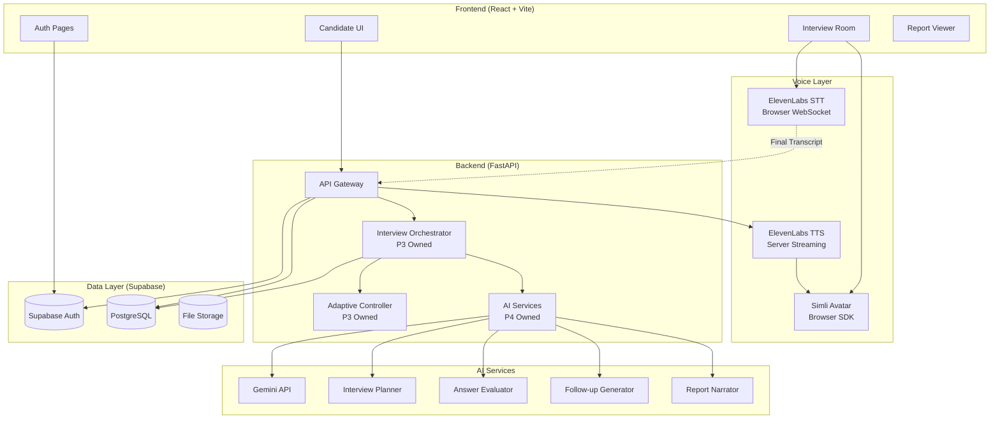
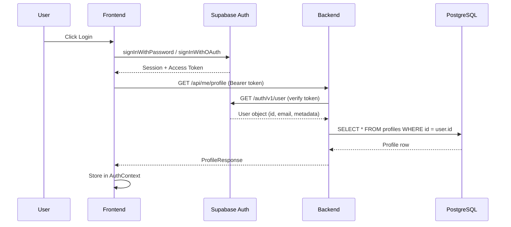
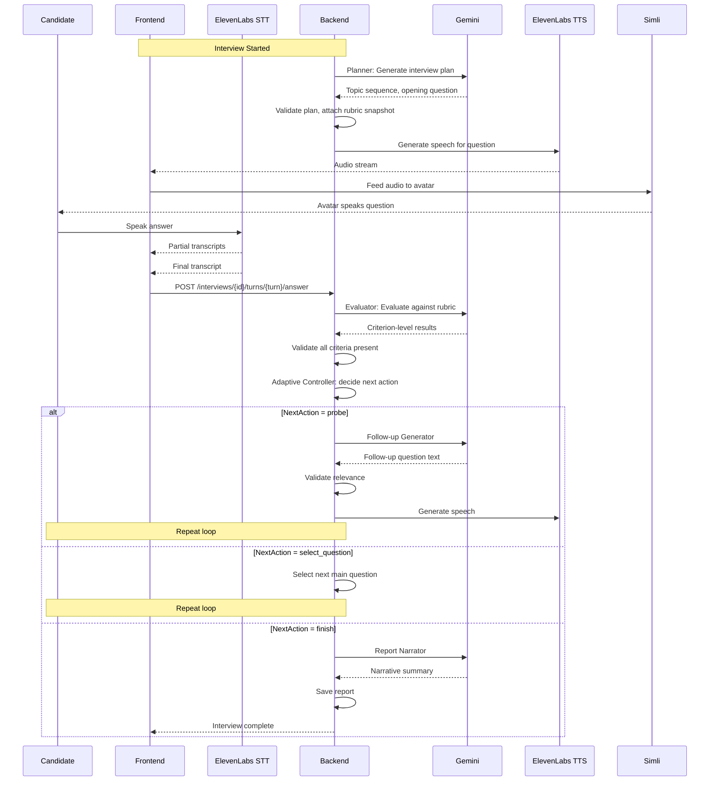
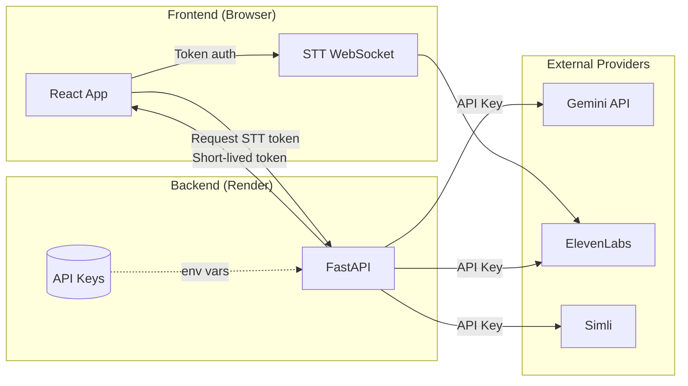

# CareerPilot MVP Architecture

> **Single source of truth for system design, technology stack, component responsibilities, and team ownership.**

---

## Table of Contents

1. [System Overview](#system-overview)
2. [Technology Stack](#technology-stack)
3. [High-Level Architecture](#high-level-architecture)
4. [Three Core Systems](#three-core-systems)
5. [Component Responsibilities](#component-responsibilities)
6. [Team Ownership Matrix](#team-ownership-matrix)
7. [Data Flow Diagrams](#data-flow-diagrams)
8. [Security Architecture](#security-architecture)
9. [Deployment Architecture](#deployment-architecture)
10. [Key Architectural Decisions](#key-architectural-decisions)

---

## System Overview

CareerPilot is an **AI-powered adaptive technical mock interview platform** for university students, fresh graduates, and entry-level developers. The platform simulates realistic technical interviews using:

- Company-specific interview experiences
- Candidate information and resume analysis
- Curated question bank with evaluation rubrics
- AI-based answer evaluation (Gemini)
- Dynamically generated follow-up questions
- Adaptive difficulty based on skill evidence
- Human-like virtual interviewer (ElevenLabs + Simli)

### What CareerPilot Is NOT

- A general-purpose LLM chatbot with an avatar
- A static question-answer flashcard system
- A video recording mock interview tool

### Core Differentiators

1. **Dynamic follow-up generation** — Questions adapt to the candidate's actual answer
2. **Evidence-based evaluation** — Criterion-level scoring against prepared rubrics
3. **Persistent skill tracking** — Performance history personalizes future interviews
4. **Human-like interaction** — Voice-based interview with avatar interviewer

---

## Technology Stack

### Agreed Stack (MVP)

| Layer | Technology | Version | Purpose |
|-------|------------|---------|---------|
| **Frontend** | React | 18.3.x | Candidate interface |
| **Build Tool** | Vite | 6.x | Fast development and bundling |
| **Styling** | Tailwind CSS | 4.x | Utility-first styling |
| **Backend** | FastAPI | 0.110+ | Interview orchestration and APIs |
| **Validation** | Pydantic | 2.6+ | Request/response validation |
| **HTTP Client** | httpx | 0.27+ | Async HTTP calls |
| **LLM** | Google Gemini API | Latest | Planning, evaluation, follow-up generation |
| **Speech-to-Text** | ElevenLabs Realtime STT | Latest | Candidate speech transcription |
| **Text-to-Speech** | ElevenLabs TTS | Latest | Interviewer speech generation |
| **Avatar** | Simli | Latest | Human-like interviewer rendering |
| **Database** | Supabase PostgreSQL | - | Persistent application data |
| **Auth** | Supabase Auth | - | User authentication (PKCE + OAuth) |
| **File Storage** | Supabase Storage | - | Resume storage (optional) |
| **Frontend Hosting** | Vercel | - | Frontend deployment |
| **Backend Hosting** | Render | - | FastAPI deployment |

### Existing Implementation Status

| Component | Status | Notes |
|-----------|--------|-------|
| React + Vite + Tailwind | ✅ Working | JS only (no TypeScript yet) |
| Supabase Auth (PKCE + Google OAuth) | ✅ Working | Full flow implemented |
| FastAPI + Pydantic | ✅ Working | Profile + Career Intelligence APIs |
| Supabase PostgreSQL | ✅ Working | 5 migrations applied |
| Gemini SDK | ❌ Not added | Needs `google-genai` in requirements |
| ElevenLabs SDK | ❌ Not added | Needs `elevenlabs` in requirements |
| Simli SDK | ❌ Not added | Needs browser + server integration |

---

## High-Level Architecture



---

## Three Core Systems

The platform operates as three interconnected systems:

### System 1: Interview Preparation

**Purpose:** Determine what should initially be assessed.

**Flow:**
1. Candidate configures interview (company, role, round, duration)
2. Backend retrieves candidate profile and skill history
3. Gemini Planner proposes topic sequence and opening questions
4. Backend validates plan against question bank
5. Interview record and first turn are persisted

**Owner:** P3 (orchestration) + P4 (AI planning)

### System 2: Live Interview

**Purpose:** Conduct the interview, evaluate answers, adapt difficulty.

**Flow:**
1. Question is spoken via TTS → Simli avatar
2. Candidate answers verbally → STT transcription
3. Backend evaluates answer against rubric (Gemini Evaluator)
4. Adaptive Controller decides next action
5. Follow-up generated if needed (Gemini Follow-up Generator)
6. Cycle repeats until stopping condition

**Owner:** P3 (adaptive controller, state machine) + P4 (AI evaluation, TTS/STT)

### System 3: Learning and Evaluation

**Purpose:** Store evidence, generate reports, personalize future interviews.

**Flow:**
1. Interview ends → finalization triggered
2. All evaluations aggregated
3. Skill evidence updated in candidate profile
4. Gemini generates narrative report
5. Report persisted and displayed

**Owner:** P3 (orchestration) + P4 (narrative generation) + P2 (data persistence)

---

## Component Responsibilities

### Frontend Components (P1)

| Component | Responsibility | Status |
|-----------|---------------|--------|
| `AuthContext` | Session management, token handling | ✅ Existing |
| `DashboardLayout` | App shell, navigation | ✅ Existing |
| `Login` / `Signup` | Authentication flows | ✅ Existing |
| `Profile` | User profile management | ✅ Existing |
| `Recruiters` | Company directory (live API) | ✅ Existing |
| `Dashboard` | Overview stats | ⚠️ Demo data only |
| `InterviewSetup` | Interview configuration wizard | ❌ Not started |
| `InterviewRoom` | Live interview UI + voice | ❌ Not started |
| `InterviewReport` | Criterion-level feedback | ❌ Not started |

### Backend Services (P3 + P4)

| Service | Owner | Responsibility | Status |
|---------|-------|---------------|--------|
| `app/core/security.py` | P3 | JWT verification via Supabase | ✅ Existing |
| `app/services/supabase.py` | P3 | PostgREST client | ✅ Existing |
| `app/routers/profiles.py` | P3 | Profile CRUD | ✅ Existing |
| `app/routers/recruiters.py` | P3 | Company directory | ✅ Existing |
| `app/routers/interviews.py` | P3 | Interview lifecycle | ❌ Not started |
| `app/core/adaptive.py` | P3 | NextAction decision logic | ❌ Not started |
| `app/services/gemini.py` | P4 | Gemini client singleton | ❌ Not started |
| `app/services/planner.py` | P4 | Interview plan generation | ❌ Not started |
| `app/services/evaluator.py` | P4 | Answer evaluation | ❌ Not started |
| `app/services/followup.py` | P4 | Follow-up question generation | ❌ Not started |
| `app/services/tts.py` | P4 | ElevenLabs TTS streaming | ❌ Not started |
| `app/services/stt.py` | P4 | STT token generation | ❌ Not started |

#### Phase 1 AI and voice service interfaces

P3 imports the provider-neutral models from `app.schemas.interview_ai` and calls
P4's async service functions. These functions return validated values only; they
do not write to Supabase or transition interview state.

```python
from app.services.gemini_service import evaluate_answer, generate_followup

result = await evaluate_answer(turn_input)       # QuestionEvaluationSchema
follow_up = await generate_followup(turn_input)  # FollowUpGenerationSchema
```

`QuestionEvaluationSchema` uses normalized scores from `0.0` to `1.0`, matching
the API contract. Provider failures return conservative, schema-valid fallback
objects with unavailable scores set to `null`, so P3 can distinguish service
failure from a real zero score and choose whether to retry, clarify, or return `503`.

`VoiceService.synthesize_speech(text)` returns `AudioResult` containing audio
bytes, media type, and an `is_mock` flag. `VoiceService.transcribe_audio(bytes)`
is a Phase 1 file-based STT demonstration. Production remains browser-direct
ElevenLabs realtime STT as required by Decision 5; the backend receives only the
final transcript.

### Database Tables (P2)

| Table | Owner | Purpose | Status |
|-------|-------|---------|--------|
| `profiles` | P2 | Student profiles | ✅ Existing |
| `recruiters` | P2 | Company records | ✅ Existing |
| `roles` | P2 | Job roles | ✅ Existing |
| `interview_experiences` | P2 | Historical interview data | ✅ Existing |
| `interview_questions` | P2 | Historical questions | ✅ Existing |
| `skills` | P2 | Skill taxonomy | ❌ Not started |
| `question_bank` | P2 | Rubric-linked questions | ❌ Not started |
| `question_rubrics` | P2 | Evaluation rubrics | ❌ Not started |
| `rubric_criteria` | P2 | Individual criteria | ❌ Not started |
| `interviews` | P2 | Live interview sessions | ❌ Not started |
| `interview_turns` | P2 | Questions asked per session | ❌ Not started |
| `answers` | P2 | Candidate transcripts | ❌ Not started |
| `evaluations` | P2 | AI evaluation results | ❌ Not started |
| `evaluation_criterion_results` | P2 | Per-criterion scores | ❌ Not started |
| `candidate_skill_states` | P2 | Skill difficulty tracking | ❌ Not started |
| `interview_reports` | P2 | Final reports | ❌ Not started |

---

## Team Ownership Matrix

### P1 — Frontend Developer

**Stack:** React, Vite, Tailwind CSS, JavaScript (→ TypeScript progressive)

**Owns:**
- All React components and pages
- Browser-side Supabase Auth SDK usage
- ElevenLabs STT browser WebSocket integration
- Simli browser SDK integration
- TTS audio buffering and avatar rendering
- Interview room state machine (UI layer only)

**Does NOT own:**
- Backend logic or state transitions
- AI service calls
- Database schema or migrations

### P2 — Database Developer

**Stack:** PostgreSQL, SQL, Supabase Dashboard, PostgREST

**Owns:**
- All database migrations (committed to Git)
- Table schemas, relationships, constraints
- Row-Level Security policies
- Indexes and query optimization
- Seed data (question bank, rubrics)
- Database documentation

**Does NOT own:**
- Application logic
- API endpoints
- AI prompts or evaluation

### P3 — Backend A: Interview Orchestration

**Stack:** Python, FastAPI, Pydantic, httpx

**Owns:**
- FastAPI application and routing
- JWT verification and ownership checks
- Interview lifecycle state machine
- Adaptive controller (NextAction decisions)
- Question selection logic
- Skill evidence aggregation
- Report orchestration
- All interview state persistence

**Critical boundary:** P3 is the **single interview controller**. No second controller in AI services, voice agents, or frontend.

### P4 — Backend B: AI & Provider Services

**Stack:** Gemini SDK, ElevenLabs SDK, Pydantic schemas

**Owns:**
- Gemini client and prompt management
- Interview planner service
- Answer evaluator service
- Follow-up generator service
- Report narrator service
- ElevenLabs TTS server integration
- ElevenLabs STT token endpoint
- Simli server session integration
- Evaluation benchmark and calibration

**Critical boundary:** P4 returns AI service results. P4 does NOT transition interview state or make adaptive decisions.

---

## Data Flow Diagrams

### Authentication Flow



### Interview Loop Flow



---

## Security Architecture

### Authentication Model

```
┌─────────────────────────────────────────────────────────────────┐
│                     SECURITY BOUNDARIES                          │
├─────────────────────────────────────────────────────────────────┤
│                                                                  │
│  ┌──────────────┐    Token    ┌──────────────┐                  │
│  │   Frontend   │ ──────────► │   Backend    │                  │
│  │  (Browser)   │             │  (FastAPI)   │                  │
│  └──────────────┘             └──────┬───────┘                  │
│         │                            │                          │
│         │ PKCE OAuth                 │ Verify via /auth/v1/user │
│         ▼                            ▼                          │
│  ┌──────────────┐             ┌──────────────┐                  │
│  │ Supabase Auth│◄────────────│ Supabase Auth│                  │
│  │  (Browser)   │             │   (Server)   │                  │
│  └──────────────┘             └──────────────┘                  │
│                                                                  │
│  USER ID SOURCE: Only from Supabase /auth/v1/user response      │
│  NEVER: From JWT decode, client request, or URL parameter       │
│                                                                  │
└─────────────────────────────────────────────────────────────────┘
```

### API Key Security

| Key | Location | Exposure |
|-----|----------|----------|
| `SUPABASE_URL` | Backend `.env` | Safe (public Supabase URL) |
| `SUPABASE_PUBLISHABLE_KEY` | Frontend + Backend | Safe (designed for client use) |
| `SUPABASE_SERVICE_ROLE_KEY` | Backend `.env` only | **Never expose** — admin operations only |
| `GEMINI_API_KEY` | Backend `.env` only | **Never expose** |
| `ELEVENLABS_API_KEY` | Backend `.env` only | **Never expose** |
| `SIMLI_API_KEY` | Backend `.env` only | **Never expose** |

### Provider Key Flow



### Row-Level Security Summary

| Table | SELECT | INSERT | UPDATE | DELETE |
|-------|--------|--------|--------|--------|
| `profiles` | Owner only | Owner only | Owner only | — |
| `recruiters` | Authenticated | — | — | — |
| `roles` | Authenticated | — | — | — |
| `interview_experiences` | Authenticated | — | — | — |
| `interview_questions` | Authenticated | — | — | — |
| `question_bank` | Authenticated | Service role | Service role | — |
| `interviews` | Owner only | Owner only | Owner only | — |
| `interview_turns` | Via interview owner | Via interview owner | Via interview owner | — |
| `evaluations` | Via interview owner | Service role | — | — |

---

## Deployment Architecture

### Current Deployment

```
┌─────────────────────────────────────────────────────────────────┐
│                      PRODUCTION                                  │
├─────────────────────────────────────────────────────────────────┤
│                                                                  │
│  ┌────────────────────┐         ┌────────────────────┐          │
│  │      Vercel        │         │      Render        │          │
│  │                    │         │                    │          │
│  │  React Frontend    │ ──API──►│  FastAPI Backend   │          │
│  │  career-pilot-     │         │  careerpilot-5tiz  │          │
│  │  nine-omega.       │         │  .onrender.com     │          │
│  │  vercel.app        │         │                    │          │
│  └────────────────────┘         └─────────┬──────────┘          │
│                                           │                      │
│                                           ▼                      │
│                              ┌────────────────────┐             │
│                              │     Supabase       │             │
│                              │                    │             │
│                              │  Auth + PostgreSQL │             │
│                              │  + Storage         │             │
│                              └────────────────────┘             │
│                                                                  │
└─────────────────────────────────────────────────────────────────┘
```

### Required Deployment Config

**Backend (`render.yaml`)** — Not yet created

```yaml
services:
  - type: web
    name: careerpilot-backend
    env: python
    buildCommand: pip install -r requirements.txt
    startCommand: uvicorn app.main:app --host 0.0.0.0 --port $PORT
    envVars:
      - key: SUPABASE_URL
        sync: false
      - key: SUPABASE_PUBLISHABLE_KEY
        sync: false
      - key: SUPABASE_SERVICE_ROLE_KEY
        sync: false
      - key: GEMINI_API_KEY
        sync: false
      - key: ELEVENLABS_API_KEY
        sync: false
      - key: SIMLI_API_KEY
        sync: false
      - key: FRONTEND_ORIGIN
        value: https://career-pilot-nine-omega.vercel.app
```

---

## Key Architectural Decisions

### Decision 1: Single Interview Controller

**Decision:** P3 (Backend Orchestration) is the single owner of interview state and adaptive decisions.

**Rationale:**
- Prevents race conditions between multiple controllers
- Ensures consistent state transitions
- Makes debugging and testing deterministic
- Follows single-responsibility principle

**Implication:** P4 AI services return results only. They never call database writes or transition interview state.

### Decision 2: Token-Forwarding Auth (Not Local JWT Decode)

**Decision:** Backend verifies tokens by calling Supabase `/auth/v1/user`, not by decoding JWT claims locally.

**Rationale:**
- Token revocation is immediate (Supabase checks its own state)
- No secret key management for JWT verification
- User metadata is always fresh
- Simpler security model

**Implication:** Every authenticated request makes one HTTP call to Supabase. Acceptable for MVP; consider caching later.

### Decision 3: Rubric Snapshot at Question Time

**Decision:** When a question is asked, its rubric is snapshotted and attached to the turn. Evaluation uses the snapshot, not the current rubric.

**Rationale:**
- Rubrics can be updated without invalidating historical evaluations
- Evaluation is always against the exact rubric the question was asked with
- Audit trail is complete

**Implication:** `interview_turns` table has a `rubric_snapshot` JSONB column.

### Decision 4: Dynamic Follow-ups (Not Fixed Lists)

**Decision:** Follow-up questions are generated dynamically by Gemini based on the candidate's actual answer and a P3-selected target criterion.

**Rationale:**
- Core differentiator of the product
- Enables genuine investigation of knowledge gaps
- Creates realistic interview experience

**Implication:** P4's follow-up generator cannot be replaced with a static question list without fundamentally changing the product.

### Decision 5: Browser-Direct STT

**Decision:** Candidate audio streams directly to ElevenLabs via browser WebSocket, not through our backend.

**Rationale:**
- Reduces latency
- Avoids backend bandwidth costs
- Follows ElevenLabs recommended architecture
- Backend only receives final transcript

**Implication:** Backend provides short-lived STT tokens. Permanent API keys never reach the browser.

### Decision 6: `interview_experiences` ≠ `question_bank`

**Decision:** The existing `interview_experiences` and `interview_questions` tables are for historical recruiter reports (read-only). New `question_bank` and related tables support live interview execution.

**Rationale:**
- Historical data has different provenance and trust level
- Live questions need rubrics, review status, difficulty levels
- Prevents data model confusion

**Implication:** Two separate table families coexist. Historical data informs preparation; question_bank drives execution.

---

## Appendix: File Structure

### Frontend

```
frontend/
├── src/
│   ├── App.jsx                 # Router
│   ├── main.jsx                # Entry point
│   ├── index.css               # Tailwind theme
│   ├── components/
│   │   ├── layout/             # DashboardLayout, Sidebar, TopBar
│   │   └── ui/                 # Avatar, Badge, Card, etc.
│   ├── context/
│   │   └── AuthContext.jsx     # Auth state management
│   ├── pages/
│   │   ├── Login.jsx
│   │   ├── Signup.jsx
│   │   ├── Dashboard.jsx
│   │   ├── Profile.jsx
│   │   ├── Recruiters.jsx
│   │   ├── InterviewSetup.jsx  # NEW
│   │   ├── InterviewRoom.jsx   # NEW
│   │   └── InterviewReport.jsx # NEW
│   ├── services/
│   │   ├── api.js              # Backend API client
│   │   └── supabase.js         # Supabase client
│   └── utils/
│       └── authRedirect.js
└── vercel.json
```

### Backend

```
backend/
├── app/
│   ├── main.py                 # FastAPI app
│   ├── core/
│   │   ├── config.py           # Settings
│   │   ├── security.py         # Auth
│   │   └── adaptive.py         # NEW: Adaptive controller
│   ├── routers/
│   │   ├── health.py
│   │   ├── profiles.py
│   │   ├── recruiters.py
│   │   ├── roles.py
│   │   └── interviews.py       # NEW: Interview lifecycle
│   ├── schemas/
│   │   ├── profile.py
│   │   ├── intelligence.py
│   │   ├── interview.py        # NEW
│   │   └── evaluation.py       # NEW
│   └── services/
│       ├── supabase.py
│       ├── gemini.py           # NEW
│       ├── planner.py          # NEW
│       ├── evaluator.py        # NEW
│       ├── followup.py         # NEW
│       ├── tts.py              # NEW
│       └── stt.py              # NEW
├── tests/
└── requirements.txt
```

### Database

```
database/
└── migrations/
    ├── 001_create_profiles.sql           # EXISTING
    ├── 002_auto_create_student_profiles.sql
    ├── 003_complete_student_profile_provisioning.sql
    ├── 004_create_career_intelligence_tables.sql
    ├── 005_seed_initial_data.sql
    ├── 006_create_question_bank.sql      # NEW
    ├── 007_create_interview_session_tables.sql  # NEW
    └── 008_seed_question_bank.sql        # NEW
```
