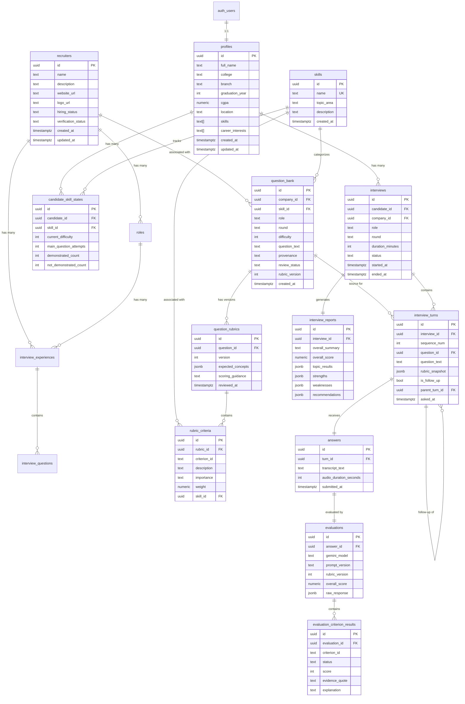

# CareerPilot Database Schema

> **Single source of truth for all database tables, relationships, indexes, RLS policies, and migrations.**

---

## Table of Contents

1. [Schema Overview](#schema-overview)
2. [Existing Tables](#existing-tables)
3. [New Tables (MVP)](#new-tables-mvp)
4. [Entity Relationship Diagram](#entity-relationship-diagram)
5. [Row-Level Security Policies](#row-level-security-policies)
6. [Indexes](#indexes)
7. [Migration Plan](#migration-plan)
8. [Seed Data Requirements](#seed-data-requirements)

---

## Schema Overview

### Table Categories

| Category | Tables | Status |
|----------|--------|--------|
| **User Management** | `profiles` | ✅ Existing |
| **Career Intelligence** | `recruiters`, `roles`, `interview_experiences`, `interview_questions` | ✅ Existing |
| **Question Bank** | `skills`, `question_bank`, `question_rubrics`, `rubric_criteria` | ❌ New |
| **Interview Sessions** | `interviews`, `interview_turns`, `answers`, `evaluations`, `evaluation_criterion_results` | ❌ New |
| **Skill Tracking** | `candidate_skill_states` | ❌ New |
| **Reports** | `interview_reports` | ❌ New |

### Naming Conventions

- Table names: `snake_case`, plural (e.g., `interview_turns`)
- Column names: `snake_case` (e.g., `created_at`)
- Primary keys: `id` (UUID)
- Foreign keys: `{referenced_table_singular}_id` (e.g., `interview_id`)
- Timestamps: `created_at`, `updated_at` with `TIMESTAMPTZ`
- Enums: Implemented as `TEXT` with `CHECK` constraints

---

## Existing Tables

### `profiles`

**Migration:** `001_create_profiles.sql`, `002_auto_create_student_profiles.sql`, `003_complete_student_profile_provisioning.sql`

**Purpose:** Student profile data linked to Supabase Auth users.

| Column | Type | Constraints | Description |
|--------|------|-------------|-------------|
| `id` | `UUID` | PK, FK → `auth.users(id)` ON DELETE CASCADE | User ID from Supabase Auth |
| `full_name` | `TEXT` | nullable | Display name |
| `college` | `TEXT` | nullable | College/university name |
| `branch` | `TEXT` | nullable | Branch/major |
| `graduation_year` | `INTEGER` | nullable | Expected graduation year |
| `cgpa` | `NUMERIC(4,2)` | CHECK 0-10, nullable | Cumulative GPA |
| `location` | `TEXT` | nullable | Current location |
| `skills` | `TEXT[]` | default `'{}'` | Self-reported skills |
| `career_interests` | `TEXT[]` | default `'{}'` | Career interest areas |
| `created_at` | `TIMESTAMPTZ` | default `now()` | Record creation time |
| `updated_at` | `TIMESTAMPTZ` | default `now()` | Last update time |

**Trigger:** `trigger_profiles_updated_at` — Updates `updated_at` on row modification.

**Auto-provisioning:** `handle_new_user()` function creates a profile row automatically when a user signs up.

---

### `recruiters`

**Migration:** `004_create_career_intelligence_tables.sql`, `005_seed_initial_data.sql`

**Purpose:** Company/recruiter records for career intelligence.

| Column | Type | Constraints | Description |
|--------|------|-------------|-------------|
| `id` | `UUID` | PK, default `gen_random_uuid()` | Unique identifier |
| `name` | `TEXT` | NOT NULL | Company name |
| `description` | `TEXT` | nullable | Company description |
| `website_url` | `TEXT` | nullable | Company website |
| `logo_url` | `TEXT` | nullable | Logo image URL |
| `hiring_status` | `TEXT` | nullable | Current hiring status |
| `data_source` | `TEXT` | nullable | Where data was sourced |
| `source_url` | `TEXT` | nullable | Source URL |
| `verification_status` | `TEXT` | NOT NULL, CHECK, default `'unverified'` | `unverified`, `verified`, `flagged`, `rejected` |
| `created_at` | `TIMESTAMPTZ` | default `now()` | Record creation time |
| `updated_at` | `TIMESTAMPTZ` | default `now()` | Last update time |

---

### `roles`

**Migration:** `004_create_career_intelligence_tables.sql`

**Purpose:** Job roles/positions offered by recruiters.

| Column | Type | Constraints | Description |
|--------|------|-------------|-------------|
| `id` | `UUID` | PK, default `gen_random_uuid()` | Unique identifier |
| `recruiter_id` | `UUID` | NOT NULL, FK → `recruiters(id)` ON DELETE CASCADE | Parent company |
| `title` | `TEXT` | NOT NULL | Job title |
| `job_type` | `TEXT` | CHECK `internship/full-time/other`, nullable | Employment type |
| `description` | `TEXT` | nullable | Role description |
| `minimum_cgpa` | `NUMERIC(4,2)` | CHECK 0-10, nullable | Minimum required CGPA |
| `eligible_branches` | `TEXT[]` | nullable | Eligible branches/majors |
| `eligible_graduation_years` | `INTEGER[]` | nullable | Eligible grad years |
| `required_skills` | `TEXT[]` | NOT NULL, default `'{}'` | Must-have skills |
| `preferred_skills` | `TEXT[]` | NOT NULL, default `'{}'` | Nice-to-have skills |
| `location` | `TEXT` | nullable | Job location |
| `application_url` | `TEXT` | nullable | Application link |
| `source_url` | `TEXT` | nullable | Source URL |
| `verification_status` | `TEXT` | NOT NULL, CHECK, default `'unverified'` | Verification state |
| `created_at` | `TIMESTAMPTZ` | default `now()` | Record creation time |
| `updated_at` | `TIMESTAMPTZ` | default `now()` | Last update time |

---

### `interview_experiences`

**Migration:** `004_create_career_intelligence_tables.sql`

**Purpose:** Historical interview experience reports from students/sources.

| Column | Type | Constraints | Description |
|--------|------|-------------|-------------|
| `id` | `UUID` | PK, default `gen_random_uuid()` | Unique identifier |
| `recruiter_id` | `UUID` | NOT NULL, FK → `recruiters(id)` ON DELETE CASCADE | Company |
| `role_id` | `UUID` | FK → `roles(id)` ON DELETE SET NULL, nullable | Associated role |
| `title` | `TEXT` | NOT NULL | Experience title |
| `interview_year` | `INTEGER` | nullable | Year of interview |
| `round_name` | `TEXT` | nullable | Round name (e.g., "Technical Round 1") |
| `experience_text` | `TEXT` | nullable | Full experience narrative |
| `source_type` | `TEXT` | NOT NULL, CHECK | `student_report`, `public_source`, `official`, `demo` |
| `source_name` | `TEXT` | nullable | Source attribution |
| `source_url` | `TEXT` | nullable | Source link |
| `verification_status` | `TEXT` | NOT NULL, CHECK, default `'unverified'` | Verification state |
| `created_at` | `TIMESTAMPTZ` | default `now()` | Record creation time |

---

### `interview_questions`

**Migration:** `004_create_career_intelligence_tables.sql`

**Purpose:** Questions reported in historical interview experiences.

| Column | Type | Constraints | Description |
|--------|------|-------------|-------------|
| `id` | `UUID` | PK, default `gen_random_uuid()` | Unique identifier |
| `experience_id` | `UUID` | NOT NULL, FK → `interview_experiences(id)` ON DELETE CASCADE | Parent experience |
| `question_text` | `TEXT` | NOT NULL | Question text |
| `topic` | `TEXT` | nullable | Topic area |
| `difficulty` | `TEXT` | nullable | Difficulty level (free-form) |
| `question_type` | `TEXT` | nullable | Question type |
| `created_at` | `TIMESTAMPTZ` | default `now()` | Record creation time |

> **Note:** This table stores historical questions from interview experiences. It is NOT the same as `question_bank` which stores rubric-linked questions for live interview execution.

---

## New Tables (MVP)

### `skills`

**Migration:** `006_create_question_bank.sql`

**Purpose:** Skill taxonomy for question categorization and candidate tracking.

| Column | Type | Constraints | Description |
|--------|------|-------------|-------------|
| `id` | `UUID` | PK, default `gen_random_uuid()` | Unique identifier |
| `name` | `TEXT` | NOT NULL, UNIQUE | Skill name (e.g., "DBMS", "Operating Systems") |
| `topic_area` | `TEXT` | NOT NULL | Parent topic area |
| `description` | `TEXT` | nullable | Skill description |
| `created_at` | `TIMESTAMPTZ` | default `now()` | Record creation time |

**Initial skills:**
- DBMS
- Operating Systems
- Data Structures and Algorithms
- Object-Oriented Programming
- Backend Development
- Computer Networks
- Problem Solving
- Project Understanding

---

### `question_bank`

**Migration:** `006_create_question_bank.sql`

**Purpose:** Curated questions with rubric associations for live interview execution.

| Column | Type | Constraints | Description |
|--------|------|-------------|-------------|
| `id` | `UUID` | PK, default `gen_random_uuid()` | Unique identifier |
| `company_id` | `UUID` | FK → `recruiters(id)` ON DELETE SET NULL, nullable | Company association (if company-specific) |
| `role` | `TEXT` | nullable | Target role |
| `round` | `TEXT` | nullable | Interview round type |
| `skill_id` | `UUID` | NOT NULL, FK → `skills(id)` | Primary skill tested |
| `difficulty` | `INTEGER` | NOT NULL, CHECK 1-5 | 1=Basic, 5=Advanced |
| `question_text` | `TEXT` | NOT NULL | Question content |
| `source` | `TEXT` | nullable | Data source |
| `provenance` | `TEXT` | NOT NULL, CHECK | `curated`, `company_reported`, `ai_generated` |
| `review_status` | `TEXT` | NOT NULL, CHECK, default `'pending'` | `pending`, `reviewed`, `rejected` |
| `rubric_version` | `INTEGER` | NOT NULL, default `1` | Current rubric version |
| `created_at` | `TIMESTAMPTZ` | default `now()` | Record creation time |
| `updated_at` | `TIMESTAMPTZ` | default `now()` | Last update time |

**Difficulty levels:**

| Level | Meaning | Example |
|-------|---------|---------|
| 1 | Basic definitions | "What is a primary key?" |
| 2 | Concept explanation | "Explain normalization and its forms." |
| 3 | Practical application | "How would you optimize this slow query?" |
| 4 | Trade-off analysis | "Compare B-tree vs. hash indexes." |
| 5 | Advanced design | "Design a distributed database schema for..." |

---

### `question_rubrics`

**Migration:** `006_create_question_bank.sql`

**Purpose:** Evaluation rubrics attached to questions.

| Column | Type | Constraints | Description |
|--------|------|-------------|-------------|
| `id` | `UUID` | PK, default `gen_random_uuid()` | Unique identifier |
| `question_id` | `UUID` | NOT NULL, FK → `question_bank(id)` ON DELETE CASCADE | Parent question |
| `version` | `INTEGER` | NOT NULL, default `1` | Rubric version number |
| `expected_concepts` | `JSONB` | NOT NULL | Key concepts expected in answer |
| `scoring_guidance` | `TEXT` | nullable | General scoring instructions |
| `reviewed_at` | `TIMESTAMPTZ` | nullable | When rubric was reviewed |
| `reviewed_by` | `TEXT` | nullable | Reviewer identifier |
| `created_at` | `TIMESTAMPTZ` | default `now()` | Record creation time |

**UNIQUE constraint:** `(question_id, version)`

**`expected_concepts` structure:**
```json
{
  "critical": ["concept1", "concept2"],
  "required": ["concept3", "concept4"],
  "optional": ["concept5"]
}
```

---

### `rubric_criteria`

**Migration:** `006_create_question_bank.sql`

**Purpose:** Individual evaluation criteria within a rubric.

| Column | Type | Constraints | Description |
|--------|------|-------------|-------------|
| `id` | `UUID` | PK, default `gen_random_uuid()` | Unique identifier |
| `rubric_id` | `UUID` | NOT NULL, FK → `question_rubrics(id)` ON DELETE CASCADE | Parent rubric |
| `criterion_id` | `TEXT` | NOT NULL | Stable identifier (e.g., `index_purpose`) |
| `description` | `TEXT` | NOT NULL | What this criterion evaluates |
| `importance` | `TEXT` | NOT NULL, CHECK | `critical`, `required`, `optional` |
| `weight` | `NUMERIC(3,2)` | NOT NULL, CHECK 0-1 | Scoring weight |
| `skill_id` | `UUID` | FK → `skills(id)`, nullable | Associated skill |
| `accepted_alternatives` | `JSONB` | nullable | Alternative valid explanations |
| `common_misconceptions` | `JSONB` | nullable | Known wrong answers |
| `created_at` | `TIMESTAMPTZ` | default `now()` | Record creation time |

**UNIQUE constraint:** `(rubric_id, criterion_id)`

---

### `interviews`

**Migration:** `007_create_interview_session_tables.sql`

**Purpose:** Live interview sessions.

| Column | Type | Constraints | Description |
|--------|------|-------------|-------------|
| `id` | `UUID` | PK, default `gen_random_uuid()` | Unique identifier |
| `candidate_id` | `UUID` | NOT NULL, FK → `profiles(id)` ON DELETE CASCADE | Candidate user |
| `company_id` | `UUID` | FK → `recruiters(id)` ON DELETE SET NULL, nullable | Target company |
| `role` | `TEXT` | nullable | Target role |
| `round` | `TEXT` | nullable | Interview round |
| `duration_minutes` | `INTEGER` | NOT NULL, CHECK > 0 | Planned duration |
| `status` | `TEXT` | NOT NULL, CHECK, default `'planned'` | Session status |
| `job_description` | `TEXT` | nullable | Optional JD text |
| `resume_url` | `TEXT` | nullable | Optional resume storage path |
| `started_at` | `TIMESTAMPTZ` | nullable | When interview started |
| `ended_at` | `TIMESTAMPTZ` | nullable | When interview ended |
| `created_at` | `TIMESTAMPTZ` | default `now()` | Record creation time |
| `updated_at` | `TIMESTAMPTZ` | default `now()` | Last update time |

**Status values:**

| Status | Meaning |
|--------|---------|
| `planned` | Created but not started |
| `active` | Interview in progress |
| `paused` | Temporarily paused |
| `finalizing` | Generating report |
| `completed` | Successfully finished |
| `abandoned` | Cancelled or timed out |

---

### `interview_turns`

**Migration:** `007_create_interview_session_tables.sql`

**Purpose:** Individual question-answer turns within an interview.

| Column | Type | Constraints | Description |
|--------|------|-------------|-------------|
| `id` | `UUID` | PK, default `gen_random_uuid()` | Unique identifier |
| `interview_id` | `UUID` | NOT NULL, FK → `interviews(id)` ON DELETE CASCADE | Parent interview |
| `sequence_num` | `INTEGER` | NOT NULL | Order within interview |
| `question_id` | `UUID` | FK → `question_bank(id)`, nullable | Source question (null if generated follow-up) |
| `question_text` | `TEXT` | NOT NULL | Actual question asked |
| `rubric_snapshot` | `JSONB` | NOT NULL | Frozen rubric at question time |
| `is_follow_up` | `BOOLEAN` | NOT NULL, default `false` | Whether this is a follow-up |
| `parent_turn_id` | `UUID` | FK → `interview_turns(id)`, nullable | Parent turn for follow-ups |
| `target_criterion_id` | `TEXT` | nullable | Criterion being probed (for follow-ups) |
| `asked_at` | `TIMESTAMPTZ` | default `now()` | When question was asked |
| `created_at` | `TIMESTAMPTZ` | default `now()` | Record creation time |

**UNIQUE constraint:** `(interview_id, sequence_num)`

**`rubric_snapshot` structure:**
```json
{
  "rubric_id": "uuid",
  "version": 1,
  "expected_concepts": {...},
  "criteria": [
    {
      "criterion_id": "index_purpose",
      "description": "...",
      "importance": "critical",
      "weight": 0.3
    }
  ]
}
```

---

### `answers`

**Migration:** `007_create_interview_session_tables.sql`

**Purpose:** Candidate answer transcripts.

| Column | Type | Constraints | Description |
|--------|------|-------------|-------------|
| `id` | `UUID` | PK, default `gen_random_uuid()` | Unique identifier |
| `turn_id` | `UUID` | NOT NULL, UNIQUE, FK → `interview_turns(id)` ON DELETE CASCADE | Parent turn |
| `transcript_text` | `TEXT` | NOT NULL | STT transcript |
| `audio_duration_seconds` | `INTEGER` | nullable | Answer duration |
| `submitted_at` | `TIMESTAMPTZ` | default `now()` | When answer was submitted |
| `created_at` | `TIMESTAMPTZ` | default `now()` | Record creation time |

---

### `evaluations`

**Migration:** `007_create_interview_session_tables.sql`

**Purpose:** AI evaluation results for answers.

| Column | Type | Constraints | Description |
|--------|------|-------------|-------------|
| `id` | `UUID` | PK, default `gen_random_uuid()` | Unique identifier |
| `answer_id` | `UUID` | NOT NULL, UNIQUE, FK → `answers(id)` ON DELETE CASCADE | Evaluated answer |
| `gemini_model` | `TEXT` | NOT NULL | Model ID used |
| `prompt_version` | `TEXT` | NOT NULL | Prompt version |
| `rubric_version` | `INTEGER` | NOT NULL | Rubric version used |
| `overall_score` | `NUMERIC(3,2)` | nullable | Computed overall score (0-1) |
| `raw_response` | `JSONB` | nullable | Full Gemini response |
| `evaluated_at` | `TIMESTAMPTZ` | default `now()` | When evaluation completed |
| `created_at` | `TIMESTAMPTZ` | default `now()` | Record creation time |

---

### `evaluation_criterion_results`

**Migration:** `007_create_interview_session_tables.sql`

**Purpose:** Per-criterion evaluation results.

| Column | Type | Constraints | Description |
|--------|------|-------------|-------------|
| `id` | `UUID` | PK, default `gen_random_uuid()` | Unique identifier |
| `evaluation_id` | `UUID` | NOT NULL, FK → `evaluations(id)` ON DELETE CASCADE | Parent evaluation |
| `criterion_id` | `TEXT` | NOT NULL | Criterion being evaluated |
| `status` | `TEXT` | NOT NULL, CHECK | Demonstration status |
| `score` | `INTEGER` | CHECK 0-4, nullable | Numeric score (null if uncertain) |
| `evidence_quote` | `TEXT` | nullable | Supporting quote from transcript |
| `explanation` | `TEXT` | nullable | AI explanation of assessment |
| `created_at` | `TIMESTAMPTZ` | default `now()` | Record creation time |

**UNIQUE constraint:** `(evaluation_id, criterion_id)`

**Status values:**

| Status | Meaning |
|--------|---------|
| `demonstrated` | Candidate clearly showed understanding |
| `partially_demonstrated` | Partial or incomplete demonstration |
| `not_demonstrated` | Concept not addressed |
| `contradicted` | Candidate showed misconception |
| `uncertain` | Transcript unclear or ambiguous |

---

### `candidate_skill_states`

**Migration:** `007_create_interview_session_tables.sql`

**Purpose:** Track candidate skill levels across interviews.

| Column | Type | Constraints | Description |
|--------|------|-------------|-------------|
| `id` | `UUID` | PK, default `gen_random_uuid()` | Unique identifier |
| `candidate_id` | `UUID` | NOT NULL, FK → `profiles(id)` ON DELETE CASCADE | Candidate |
| `skill_id` | `UUID` | NOT NULL, FK → `skills(id)` | Skill being tracked |
| `current_difficulty` | `INTEGER` | NOT NULL, CHECK 1-5, default `2` | Current difficulty level |
| `main_question_attempts` | `INTEGER` | NOT NULL, default `0` | Distinct main questions attempted |
| `demonstrated_count` | `INTEGER` | NOT NULL, default `0` | Times skill was demonstrated |
| `not_demonstrated_count` | `INTEGER` | NOT NULL, default `0` | Times skill was not demonstrated |
| `last_updated` | `TIMESTAMPTZ` | default `now()` | Last evidence update |
| `created_at` | `TIMESTAMPTZ` | default `now()` | Record creation time |

**UNIQUE constraint:** `(candidate_id, skill_id)`

---

### `interview_reports`

**Migration:** `007_create_interview_session_tables.sql`

**Purpose:** Final interview reports with AI-generated narrative.

| Column | Type | Constraints | Description |
|--------|------|-------------|-------------|
| `id` | `UUID` | PK, default `gen_random_uuid()` | Unique identifier |
| `interview_id` | `UUID` | NOT NULL, UNIQUE, FK → `interviews(id)` ON DELETE CASCADE | Parent interview |
| `overall_summary` | `TEXT` | NOT NULL | Narrative performance summary |
| `overall_score` | `NUMERIC(3,2)` | nullable | Computed overall score (0-1) |
| `topic_results` | `JSONB` | NOT NULL | Per-topic breakdown |
| `strengths` | `JSONB` | NOT NULL | Identified strengths |
| `weaknesses` | `JSONB` | NOT NULL | Identified weaknesses |
| `recommendations` | `JSONB` | NOT NULL | Practice recommendations |
| `gemini_model` | `TEXT` | NOT NULL | Model used for narrative |
| `generated_at` | `TIMESTAMPTZ` | default `now()` | When report was generated |
| `created_at` | `TIMESTAMPTZ` | default `now()` | Record creation time |

**`topic_results` structure:**
```json
{
  "DBMS": {
    "questions_asked": 3,
    "average_score": 0.75,
    "demonstrated_criteria": ["index_purpose", "normalization"],
    "missing_criteria": ["transaction_isolation"]
  }
}
```

---

## Entity Relationship Diagram



---

## Row-Level Security Policies

### Existing Tables

#### `profiles`
```sql
-- Users can only read their own profile
CREATE POLICY "Users can read own profile" ON profiles
  FOR SELECT TO authenticated
  USING (id = auth.uid());

-- Users can only insert their own profile
CREATE POLICY "Users can insert own profile" ON profiles
  FOR INSERT TO authenticated
  WITH CHECK (id = auth.uid());

-- Users can only update their own profile
CREATE POLICY "Users can update own profile" ON profiles
  FOR UPDATE TO authenticated
  USING (id = auth.uid())
  WITH CHECK (id = auth.uid());
```

#### Career Intelligence Tables (`recruiters`, `roles`, `interview_experiences`, `interview_questions`)
```sql
-- All authenticated users can read (no write access)
CREATE POLICY "Allow authenticated users to read {table}" ON {table}
  FOR SELECT TO authenticated
  USING (true);
```

### New Tables

#### `skills`
```sql
-- All authenticated users can read
CREATE POLICY "Allow authenticated users to read skills" ON skills
  FOR SELECT TO authenticated
  USING (true);

-- No user write access (service role only for seeding)
```

#### `question_bank`, `question_rubrics`, `rubric_criteria`
```sql
-- All authenticated users can read reviewed questions
CREATE POLICY "Allow authenticated users to read reviewed questions" ON question_bank
  FOR SELECT TO authenticated
  USING (review_status = 'reviewed');

-- All authenticated users can read rubrics for reviewed questions
CREATE POLICY "Allow authenticated users to read rubrics" ON question_rubrics
  FOR SELECT TO authenticated
  USING (
    EXISTS (
      SELECT 1 FROM question_bank
      WHERE question_bank.id = question_rubrics.question_id
      AND question_bank.review_status = 'reviewed'
    )
  );

-- All authenticated users can read criteria for reviewed rubrics
CREATE POLICY "Allow authenticated users to read criteria" ON rubric_criteria
  FOR SELECT TO authenticated
  USING (
    EXISTS (
      SELECT 1 FROM question_rubrics
      JOIN question_bank ON question_bank.id = question_rubrics.question_id
      WHERE question_rubrics.id = rubric_criteria.rubric_id
      AND question_bank.review_status = 'reviewed'
    )
  );

-- No user write access (service role only)
```

#### `interviews`
```sql
-- Users can only read their own interviews
CREATE POLICY "Users can read own interviews" ON interviews
  FOR SELECT TO authenticated
  USING (candidate_id = auth.uid());

-- Users can only create interviews for themselves
CREATE POLICY "Users can create own interviews" ON interviews
  FOR INSERT TO authenticated
  WITH CHECK (candidate_id = auth.uid());

-- Users can only update their own interviews
CREATE POLICY "Users can update own interviews" ON interviews
  FOR UPDATE TO authenticated
  USING (candidate_id = auth.uid())
  WITH CHECK (candidate_id = auth.uid());
```

#### `interview_turns`, `answers`
```sql
-- Access via interview ownership
CREATE POLICY "Users can read turns for own interviews" ON interview_turns
  FOR SELECT TO authenticated
  USING (
    EXISTS (
      SELECT 1 FROM interviews
      WHERE interviews.id = interview_turns.interview_id
      AND interviews.candidate_id = auth.uid()
    )
  );

-- Insert via interview ownership
CREATE POLICY "Users can create turns for own interviews" ON interview_turns
  FOR INSERT TO authenticated
  WITH CHECK (
    EXISTS (
      SELECT 1 FROM interviews
      WHERE interviews.id = interview_turns.interview_id
      AND interviews.candidate_id = auth.uid()
    )
  );

-- Similar policies for answers table
```

#### `evaluations`, `evaluation_criterion_results`
```sql
-- Read via interview ownership (through answer → turn → interview chain)
CREATE POLICY "Users can read evaluations for own interviews" ON evaluations
  FOR SELECT TO authenticated
  USING (
    EXISTS (
      SELECT 1 FROM answers
      JOIN interview_turns ON interview_turns.id = answers.turn_id
      JOIN interviews ON interviews.id = interview_turns.interview_id
      WHERE answers.id = evaluations.answer_id
      AND interviews.candidate_id = auth.uid()
    )
  );

-- No user write access (service role writes evaluations)
```

#### `candidate_skill_states`
```sql
-- Users can only read their own skill states
CREATE POLICY "Users can read own skill states" ON candidate_skill_states
  FOR SELECT TO authenticated
  USING (candidate_id = auth.uid());

-- Service role manages writes (updated after evaluations)
```

#### `interview_reports`
```sql
-- Users can only read their own reports
CREATE POLICY "Users can read own reports" ON interview_reports
  FOR SELECT TO authenticated
  USING (
    EXISTS (
      SELECT 1 FROM interviews
      WHERE interviews.id = interview_reports.interview_id
      AND interviews.candidate_id = auth.uid()
    )
  );

-- Service role creates reports
```

---

## Indexes

### Existing Indexes
```sql
-- profiles
CREATE INDEX idx_profiles_user_id ON profiles(id);

-- recruiters
CREATE INDEX idx_recruiters_name ON recruiters(name);
CREATE INDEX idx_recruiters_verification ON recruiters(verification_status);

-- roles
CREATE INDEX idx_roles_recruiter_id ON roles(recruiter_id);
CREATE INDEX idx_roles_job_type ON roles(job_type);
CREATE INDEX idx_roles_verification ON roles(verification_status);

-- interview_experiences
CREATE INDEX idx_interview_experiences_recruiter_id ON interview_experiences(recruiter_id);
CREATE INDEX idx_interview_experiences_role_id ON interview_experiences(role_id);
CREATE INDEX idx_interview_experiences_source_type ON interview_experiences(source_type);
CREATE INDEX idx_interview_experiences_verification ON interview_experiences(verification_status);

-- interview_questions
CREATE INDEX idx_interview_questions_experience_id ON interview_questions(experience_id);
```

### New Indexes
```sql
-- skills
CREATE INDEX idx_skills_topic_area ON skills(topic_area);

-- question_bank
CREATE INDEX idx_question_bank_skill_id ON question_bank(skill_id);
CREATE INDEX idx_question_bank_company_id ON question_bank(company_id);
CREATE INDEX idx_question_bank_difficulty ON question_bank(difficulty);
CREATE INDEX idx_question_bank_review_status ON question_bank(review_status);
CREATE INDEX idx_question_bank_skill_difficulty ON question_bank(skill_id, difficulty);

-- question_rubrics
CREATE INDEX idx_question_rubrics_question_id ON question_rubrics(question_id);

-- rubric_criteria
CREATE INDEX idx_rubric_criteria_rubric_id ON rubric_criteria(rubric_id);
CREATE INDEX idx_rubric_criteria_skill_id ON rubric_criteria(skill_id);

-- interviews
CREATE INDEX idx_interviews_candidate_id ON interviews(candidate_id);
CREATE INDEX idx_interviews_status ON interviews(status);
CREATE INDEX idx_interviews_company_id ON interviews(company_id);
CREATE INDEX idx_interviews_candidate_status ON interviews(candidate_id, status);

-- interview_turns
CREATE INDEX idx_interview_turns_interview_id ON interview_turns(interview_id);
CREATE INDEX idx_interview_turns_question_id ON interview_turns(question_id);
CREATE INDEX idx_interview_turns_parent_id ON interview_turns(parent_turn_id);

-- answers
CREATE INDEX idx_answers_turn_id ON answers(turn_id);

-- evaluations
CREATE INDEX idx_evaluations_answer_id ON evaluations(answer_id);

-- evaluation_criterion_results
CREATE INDEX idx_eval_criterion_results_evaluation_id ON evaluation_criterion_results(evaluation_id);
CREATE INDEX idx_eval_criterion_results_criterion_id ON evaluation_criterion_results(criterion_id);

-- candidate_skill_states
CREATE INDEX idx_candidate_skill_states_candidate_id ON candidate_skill_states(candidate_id);
CREATE INDEX idx_candidate_skill_states_skill_id ON candidate_skill_states(skill_id);

-- interview_reports
CREATE INDEX idx_interview_reports_interview_id ON interview_reports(interview_id);
```

---

## Migration Plan

### Phase 1: Question Bank Schema

**Migration `006_create_question_bank.sql`:**

1. Create `skills` table
2. Create `question_bank` table
3. Create `question_rubrics` table
4. Create `rubric_criteria` table
5. Add RLS policies
6. Add indexes
7. Seed initial skills

### Phase 2: Interview Session Schema

**Migration `007_create_interview_session_tables.sql`:**

1. Create `interviews` table
2. Create `interview_turns` table
3. Create `answers` table
4. Create `evaluations` table
5. Create `evaluation_criterion_results` table
6. Create `candidate_skill_states` table
7. Create `interview_reports` table
8. Add RLS policies
9. Add indexes
10. Add triggers for `updated_at`

### Phase 3: Seed Data

**Migration `008_seed_question_bank.sql`:**

1. Insert skill taxonomy (8 skills)
2. Insert 15-20 curated questions per topic area
3. Insert rubrics with 3-5 criteria each
4. All using stable UUIDs with `ON CONFLICT DO NOTHING`

---

## Seed Data Requirements

### Skills (8 initial)

| Skill | Topic Area |
|-------|------------|
| DBMS | Core CS |
| Operating Systems | Core CS |
| Data Structures and Algorithms | Core CS |
| Object-Oriented Programming | Core CS |
| Backend Development | Development |
| Computer Networks | Core CS |
| Problem Solving | General |
| Project Understanding | General |

### Question Bank (Minimum for MVP)

| Topic | Questions | Difficulty Range |
|-------|-----------|------------------|
| DBMS | 5 | 1-4 |
| Operating Systems | 5 | 1-4 |
| Data Structures and Algorithms | 5 | 1-4 |
| Object-Oriented Programming | 3 | 1-3 |
| Backend Development | 3 | 1-3 |
| **Total** | **21** | |

### Per-Question Requirements

Each seeded question must have:
- Reviewed rubric (`review_status = 'reviewed'`)
- 3-5 criteria with weights summing to 1.0
- At least 1 critical criterion
- Expected concepts documented
- Provenance marked as `curated`

---

## Data Integrity Rules

1. **Rubric snapshots are immutable** — Once attached to a turn, never modified
2. **Evaluations reference snapshot** — Evaluation uses `rubric_snapshot` from turn, not current rubric
3. **Skill evidence is aggregated** — Updated after each main-question evaluation, not follow-ups
4. **Follow-ups reference parent** — `parent_turn_id` creates audit trail
5. **Questions can be soft-rejected** — `review_status = 'rejected'` hides from selection, preserves history
6. **Cascade deletes are intentional** — Deleting an interview removes all child records
7. **Historical questions are separate** — `interview_questions` (historical) ≠ `question_bank` (live execution)
