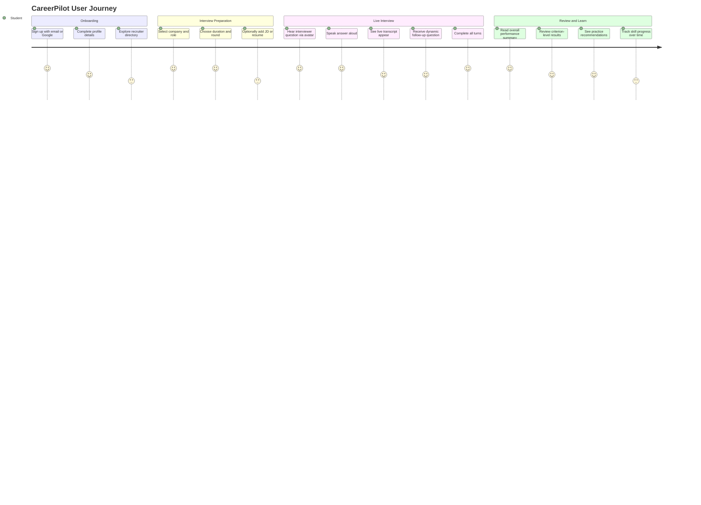
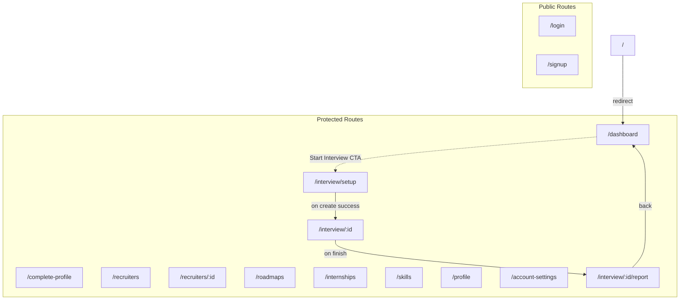
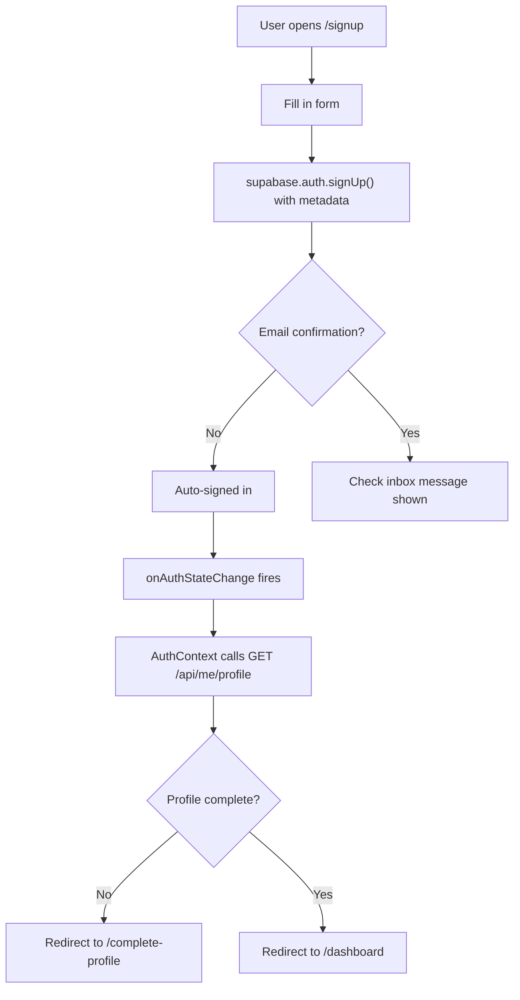
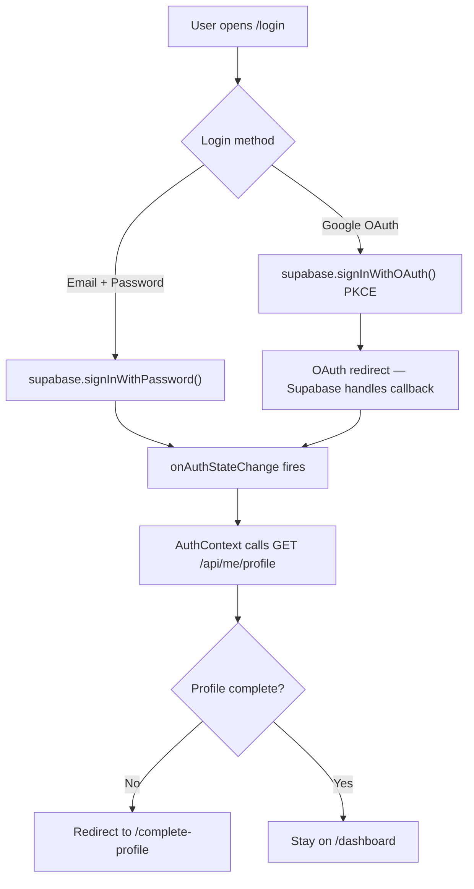
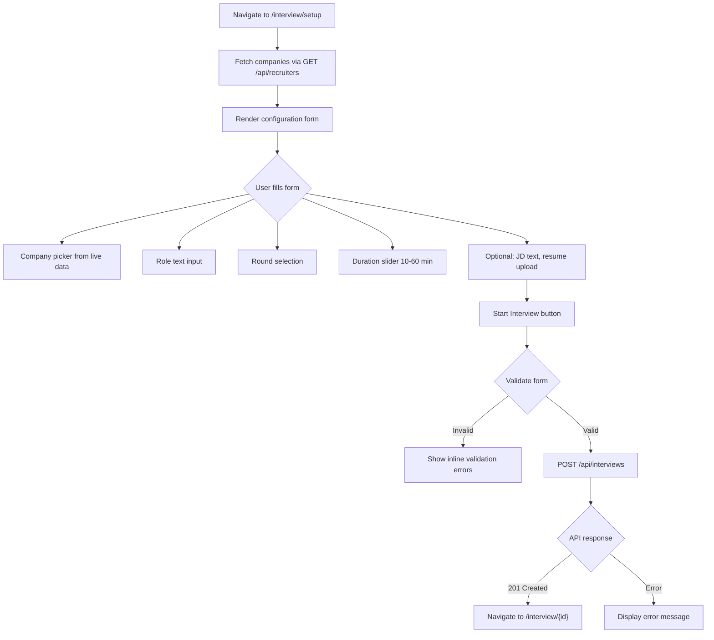
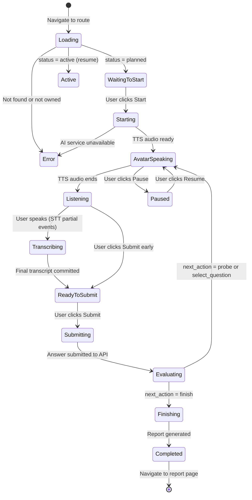
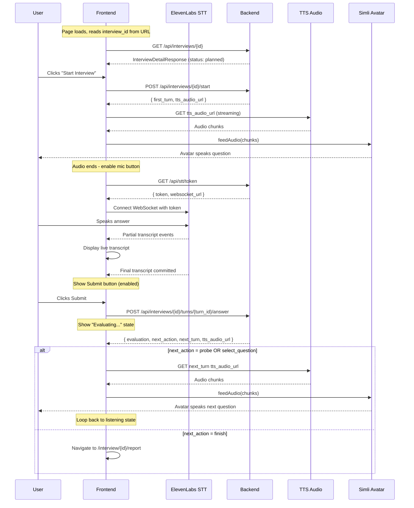
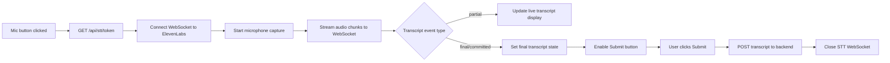
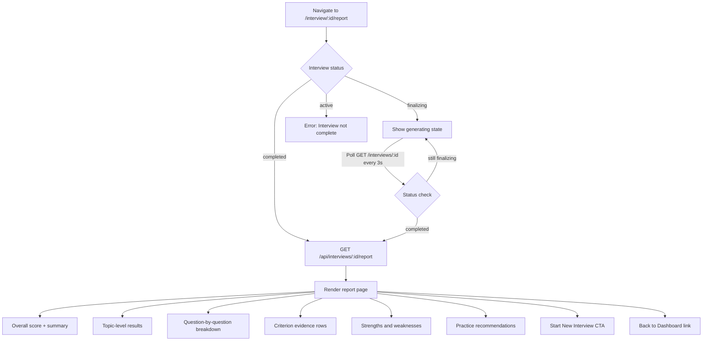
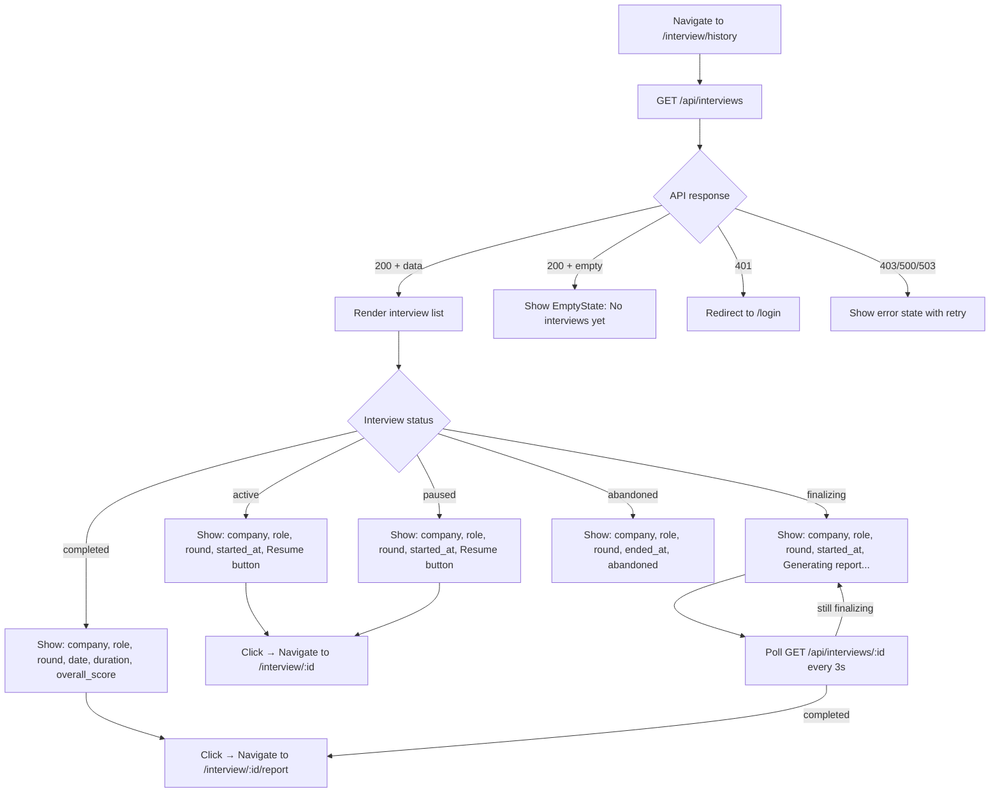

# CareerPilot Frontend Flow

> **Single source of truth for frontend pages, user journey, UI states, API interactions, and voice/avatar integration.**

---

## Table of Contents

1. [Application Overview](#application-overview)
2. [Page Inventory](#page-inventory)
3. [User Journey Map](#user-journey-map)
4. [Routing Structure](#routing-structure)
5. [Authentication Flow](#authentication-flow)
6. [Interview Setup Flow](#interview-setup-flow)
7. [Interview Room Flow](#interview-room-flow)
8. [Voice and Avatar Integration](#voice-and-avatar-integration)
9. [Report Flow](#report-flow)
10. [State Management](#state-management)
11. [API Interactions by Page](#api-interactions-by-page)
12. [UI Component Reference](#ui-component-reference)
13. [Design System](#design-system)
14. [Interview History Flow](#interview-history-flow)
15. [P1 Implementation Dependencies](#p1-implementation-dependencies)
16. [Phase Boundaries](#phase-boundaries)

---

## Application Overview

The CareerPilot frontend is a **React 18 + Vite** single-page application styled with **Tailwind CSS v4**. It uses **React Router v7** for client-side routing, **Supabase Auth** for authentication, and native `fetch` for API calls.

### Key Characteristics

- **JavaScript only** — No TypeScript yet. New files stay `.jsx`/`.js` for now; convert to `.tsx`/`.ts` post-MVP when touched.
- **No external state library** — React Context + useState + useRef.
- **Demo mode** — Entire app works without credentials for development. Set by `isDemoMode` from AuthContext.
- **Deep navy theme** — Dark-first, `#070B16` background, violet/cyan accents.
- **Font stack** — Space Grotesk (headings), DM Sans (body). Loaded via Google Fonts in `index.html`.

---

## Page Inventory

### Existing Pages

| Page | Route | Status | Data Source |
|------|-------|--------|-------------|
| Login | `/login` | ✅ Working | Supabase Auth |
| Signup | `/signup` | ✅ Working | Supabase Auth |
| Complete Profile | `/complete-profile` | ✅ Working | Supabase direct (fix: should call API) |
| Dashboard | `/dashboard` | ⚠️ Demo data | Static `demoData.js` |
| Recruiters | `/recruiters` | ✅ Working | Live API |
| Recruiter Detail | `/recruiters/:id` | ✅ Working | Live API |
| Roadmaps | `/roadmaps` | ⚠️ Demo data | Static `demoData.js` |
| Internships | `/internships` | ⚠️ Demo data | Static `demoData.js` |
| Skills | `/skills` | ⚠️ Demo data | Static `demoData.js` |
| Profile | `/profile` | ✅ Working | Live API |
| Account Settings | `/account-settings` | ✅ Working | Supabase Auth |

### New Pages (MVP)

| Page | Route | Status | Description |
|------|-------|--------|-------------|
| Interview Setup | `/interview/setup` | ❌ Not started | Interview configuration wizard |
| Interview Room | `/interview/:id` | ❌ Not started | Live voice interview with avatar |
| Interview Report | `/interview/:id/report` | ❌ Not started | Criterion-level performance feedback |

> **Fix needed (Phase 0):** `CompleteProfile.jsx` calls `supabase.from('profiles').upsert(...)` directly. It should call `PATCH /api/me/profile` for consistency with the rest of the app.

---

## User Journey Map



---

## Routing Structure



### Route Guard Behavior

| Guard | Purpose | Behavior |
|-------|---------|----------|
| `ProtectedRoute` | Auth required | Redirects unauthenticated users to `/login` |
| `PublicOnlyRoute` | Unauthenticated only | Redirects authenticated users to `/dashboard` |
| Demo mode bypass | Development | `ProtectedRoute` renders children if `isDemoMode` is true |

### React Router Registration (`App.jsx`)

Add these new routes to the existing router:

```jsx
// New routes to add in App.jsx
<Route path="/interview/setup" element={
  <ProtectedRoute>
    <DashboardLayout>
      <InterviewSetup />
    </DashboardLayout>
  </ProtectedRoute>
} />

// InterviewRoom does NOT use DashboardLayout (full-screen immersive experience)
<Route path="/interview/:interviewId" element={
  <ProtectedRoute>
    <InterviewRoom />
  </ProtectedRoute>
} />

<Route path="/interview/:interviewId/report" element={
  <ProtectedRoute>
    <DashboardLayout>
      <InterviewReport />
    </DashboardLayout>
  </ProtectedRoute>
} />
```

---

## Authentication Flow

### Registration Flow



### Login Flow



### AuthContext — What It Provides

```javascript
// Available throughout the app via useAuth()
const {
  session,          // Supabase session object
  user,             // Supabase user object
  profile,          // Backend ProfileResponse
  loading,          // Auth loading state
  profileLoading,   // Profile fetch loading state
  error,            // Auth error
  profileError,     // Profile fetch error
  isConfigured,     // Whether Supabase is configured
  isDemoMode,       // Demo mode active

  // Actions
  signIn,
  signInWithOAuth,
  signUp,
  updatePassword,
  signOut,
  updateProfile,
  refreshProfile,
} = useAuth();
```

---

## Interview Setup Flow

### Page: `/interview/setup`

**Component:** `src/pages/InterviewSetup.jsx`

**Purpose:** Configure interview parameters before starting.



### Form Fields

| Field | Type | Required | Validation |
|-------|------|----------|------------|
| Company | Select from API | No | Valid company UUID if set |
| Role | Text input | No | Free text |
| Round | Select | No | Technical / HR / Design / System Design / Other |
| Duration | Slider | Yes | 10-60 minutes |
| Job Description | Textarea | No | Optional AI context |
| Resume | File upload | No | PDF only, max 5MB |

### UI States

| State | Display |
|-------|---------|
| Loading | Company list skeleton |
| Ready | Form fillable |
| Submitting | Submit button disabled with spinner |
| Error | Inline error message |

---

## Interview Room Flow

### Page: `/interview/:id`

**Component:** `src/pages/InterviewRoom.jsx`

**Purpose:** Conduct the live voice interview with avatar.

### Room State Machine



### Room Layout

```
+----------------------------------------------------------------+
|  TopBar: [Company Name]   Turn 2/8  •  DBMS  •  Timer 12:45   |
+--------------------------+-------------------------------------+
|                          |  CURRENT QUESTION                  |
|                          |  ---------------------------------  |
|      SIMLI AVATAR        |  "What is a database index,        |
|      (centered)          |   and why is it useful?"           |
|                          |                                    |
|      Animated while      |  TRANSCRIPT                        |
|      speaking            |  ---------------------------       |
|                          |  "An index is a data structure     |
|                          |   that helps the database..."      |
|                          |  (live partial updates)            |
|                          |                                    |
|                          |  +-----------------------------+   |
|                          |  |  🎤  SPEAK YOUR ANSWER     |   |
|                          |  +-----------------------------+   |
|                          |  +-----------------------------+   |
|                          |  |  ✓   SUBMIT ANSWER          |   |
|                          |  +-----------------------------+   |
+--------------------------+-------------------------------------+
|  Progress: ████████░░░░░░░░  Turn 2 of estimated 8            |
+----------------------------------------------------------------+
```

### Full Interview Room Sequence



### Component Sub-structure

```
InterviewRoom
  InterviewTopBar
    CompanyName
    TurnCounter ("Turn 2 of 8")
    CurrentSkillLabel
    SessionTimer
  SimliAvatarPanel
    SimliSDKEmbed
  QuestionPanel
    QuestionText
    TranscriptDisplay
      PartialTranscript (live, greyed out)
      FinalTranscript (committed)
    MicrophoneControl
      StartListeningButton
      SubmitAnswerButton
  ProgressBar (turn progress)
```

---

## Voice and Avatar Integration

### ElevenLabs STT — Browser-Side Flow



**Rules:**
- Request a fresh token for each turn (tokens expire in ~5 minutes)
- Display partial transcripts as the user speaks
- Submit exactly **one** final transcript per turn — not every audio chunk
- Browser audio streams directly to ElevenLabs — never through our backend
- Handle WebSocket drops gracefully: retry once, then fall back to text input

**Implementation pattern:**
```javascript
async function startListening(turnId) {
  // Get fresh token for this turn
  const { token, websocket_url } = await apiRequest('/api/stt/token', {
    accessToken: session.access_token,
  });

  const ws = new WebSocket(`${websocket_url}?token=${token}`);

  ws.onmessage = (event) => {
    const data = JSON.parse(event.data);
    if (data.type === 'partial') {
      setTranscript(prev => ({ ...prev, partial: data.text }));
    } else if (data.type === 'final') {
      setTranscript({ partial: '', final: data.text });
      setInterviewState('ready_to_submit');
    }
  };

  ws.onerror = () => handleSTTError();
  ws.onclose = () => handleSTTClose();

  sttWebSocketRef.current = ws;
}
```

### ElevenLabs TTS — Server-to-Browser Streaming

```javascript
async function playTTSAudio(audioUrl) {
  const response = await fetch(`${apiBaseUrl}${audioUrl}`, {
    headers: { Authorization: `Bearer ${session.access_token}` },
  });

  if (!response.ok) {
    console.error('TTS fetch failed:', response.status);
    setInterviewState('error');
    return;
  }

  const reader = response.body.getReader();

  while (true) {
    const { done, value } = await reader.read();
    if (done) break;

    // Frame audio per Simli's input contract
    // Exact codec, sample rate, and chunk size confirmed in Phase 2 TTS PoC
    if (simliRef.current?.isReady) {
      simliRef.current.feedAudio(value);
    }
  }

  // Audio finished — transition to listening
  setInterviewState('listening');
}
```

**Audio spec (confirmed in Phase 2 TTS PoC by P4 — values TBD):**
- Codec: TBD (typically PCM 16-bit or MP3)
- Sample rate: TBD (typically 16kHz or 22kHz)
- Channels: Mono
- Chunk size: TBD per Simli's requirement

### Simli Avatar Integration

```javascript
const simliRef = useRef(null);
const simliContainerRef = useRef(null);

useEffect(() => {
  const initSimli = async () => {
    // Simli session managed server-side — backend provides session ID
    // The Simli API key stays on the backend only
    const { session_id } = await apiRequest('/api/simli/session', {
      accessToken: session.access_token,
    });

    simliRef.current = new SimliClient({
      sessionId: session_id,
      container: simliContainerRef.current,
    });

    await simliRef.current.initialize();
  };

  initSimli().catch(() => {
    // If Simli fails: show audio-only view
    setAvatarFailed(true);
  });

  return () => {
    simliRef.current?.destroy();
  };
}, []);
```

**Failure handling:**
- If Simli fails to initialize: show audio-only view (question text visible, no avatar render)
- If TTS fails: show question text prominently; allow text input response
- If STT WebSocket drops: attempt one reconnect, then show text input fallback

---

## Report Flow

### Page: `/interview/:id/report`

**Component:** `src/pages/InterviewReport.jsx`



### Report Page Layout

```
+----------------------------------------------------------------+
|  Interview Report — TCS Technical Round                         |
|  June 20, 2024  •  28 minutes  •  8 questions                  |
+----------------------------------------------------------------+
|  OVERALL PERFORMANCE                                            |
|  72%  ████████████████████░░░░  Good Foundation                |
|  "Demonstrated solid foundational knowledge in DBMS with       |
|   clear gaps in performance trade-off analysis."               |
+----------------------------------------------------------------+
|  BY TOPIC                                                       |
|  DBMS    ████████████████░░░░  75%  •  3 questions             |
|  DSA     ████████████░░░░░░░░  65%  •  2 questions             |
|  OOP     ██████████████████░░  80%  •  2 questions             |
+----------------------------------------------------------------+
|  QUESTION BREAKDOWN                                             |
|  Q1: "What is a database index?"                               |
|    index_purpose     [demonstrated]      "An index helps..."   |
|    write_overhead    [not demonstrated]                        |
|    read_benefits     [demonstrated]      "Speeds up SELECT"    |
|  Q2 (Follow-up): "How do indexes affect writes?"              |
|    write_overhead    [partially demonstrated]                  |
+----------------------------------------------------------------+
|  STRENGTHS                |  AREAS TO IMPROVE                  |
|  - Clear definitions      |  - Write performance trade-offs    |
|  - Good examples          |  - Advanced optimization           |
|  - Systematic thinking    |  - Practical application depth     |
+----------------------------------------------------------------+
|  RECOMMENDED PRACTICE                                           |
|  1. Practice explaining index write overhead in depth          |
|  2. Study B-tree vs hash index trade-offs                      |
|  3. Review transaction isolation levels                        |
+----------------------------------------------------------------+
|       [ Start New Interview ]    [ Back to Dashboard ]         |
+----------------------------------------------------------------+
```

---

## State Management

### Global State (AuthContext)

No Redux, Zustand, or React Query. All state is managed with:
- `AuthContext` — global auth and profile state
- `useState` / `useEffect` — local component state
- `useRef` — mutable refs (Simli client, STT WebSocket, deduplication guards)
- `useMemo` — computed filtering (Recruiters, Internships)
- `useCallback` — stable action callbacks in AuthContext

### InterviewRoom Component State

```javascript
// Core interview room state
const [interviewState, setInterviewState] = useState('loading');
// Values: loading | waiting_to_start | starting | avatar_speaking |
//         listening | transcribing | ready_to_submit | submitting |
//         evaluating | finishing | completed | error

const [interview, setInterview] = useState(null);
const [currentTurn, setCurrentTurn] = useState(null);
const [transcript, setTranscript] = useState({ partial: '', final: '' });
const [evaluation, setEvaluation] = useState(null);
const [errorMessage, setErrorMessage] = useState(null);

// External SDK references (never trigger re-renders)
const simliRef = useRef(null);
const sttWebSocketRef = useRef(null);
const ttsAbortRef = useRef(null); // For cancelling in-flight TTS stream
```

### InterviewSetup Component State

```javascript
const [formData, setFormData] = useState({
  company_id: null,
  role: '',
  round: 'Technical',
  duration_minutes: 30,
  job_description: '',
  resume: null,
});
const [companies, setCompanies] = useState([]);
const [submitting, setSubmitting] = useState(false);
const [fieldErrors, setFieldErrors] = useState({});
const [submitError, setSubmitError] = useState(null);
```

---

## API Interactions by Page

### Dashboard

| Interaction | Endpoint | Status |
|-------------|----------|--------|
| Load stats | None — demo data | ⚠️ Replace post-MVP with `/api/interviews` |
| Load skill progress | `GET /api/me/skill-states` | ❌ Post-MVP |
| Load recent interviews | `GET /api/interviews?limit=5` | ❌ Post-MVP |

### Recruiters

| Interaction | Endpoint | Status |
|-------------|----------|--------|
| Load company list | `GET /api/recruiters` | ✅ Working |
| Load company detail | `GET /api/recruiters/:id` | ✅ Working |
| Load roles | `GET /api/roles?recruiter_id=:id` | ✅ Working |
| Load experiences | `GET /api/roles/:id/interview-experiences` | ✅ Working |

### Profile

| Interaction | Endpoint | Status |
|-------------|----------|--------|
| Load profile | `GET /api/me/profile` via AuthContext | ✅ Working |
| Update profile | `PATCH /api/me/profile` | ✅ Working |

### InterviewSetup

| Interaction | Endpoint | Status |
|-------------|----------|--------|
| Load companies | `GET /api/recruiters` | ✅ Existing endpoint |
| Create interview | `POST /api/interviews` | ❌ New endpoint |

### InterviewRoom

| Interaction | Endpoint | Status |
|-------------|----------|--------|
| Load interview state | `GET /api/interviews/:id` | ❌ New endpoint |
| Start interview | `POST /api/interviews/:id/start` | ❌ New endpoint |
| Get STT token | `GET /api/stt/token` | ❌ New endpoint |
| Stream TTS audio | `GET /api/interviews/:id/turns/:turn_id/audio` | ❌ New endpoint |
| Submit answer | `POST /api/interviews/:id/turns/:turn_id/answer` | ❌ New endpoint |
| Finish early | `POST /api/interviews/:id/finish` | ❌ New endpoint |

### InterviewReport

| Interaction | Endpoint | Status |
|-------------|----------|--------|
| Load report | `GET /api/interviews/:id/report` | ❌ New endpoint |
| Poll interview status | `GET /api/interviews/:id` | ❌ New endpoint |

---

## UI Component Reference

### Existing Components (Reuse These)

| Component | File | Props | Usage |
|-----------|------|-------|-------|
| `Badge` | `components/ui/Badge.jsx` | `tone: primary/secondary/muted/success` | Status chips, skill labels |
| `Card` | `components/ui/Card.jsx` | `children`, `className` | Content containers |
| `ProgressBar` | `components/ui/ProgressBar.jsx` | `value: 0-100`, `label?` | Skill progress, turn progress |
| `Avatar` | `components/ui/Avatar.jsx` | `name`, `size: sm/md/lg` | User avatar circles |
| `EmptyState` | `components/ui/EmptyState.jsx` | `title`, `description` | Empty data states |
| `SearchInput` | `components/ui/SearchInput.jsx` | `value`, `onChange`, `placeholder` | Search fields |

### New Components Needed (MVP)

| Component | File | Purpose |
|-----------|------|---------|
| `SimliAvatarPanel` | `components/interview/SimliAvatarPanel.jsx` | Simli SDK avatar container |
| `TranscriptDisplay` | `components/interview/TranscriptDisplay.jsx` | Live STT transcript (partial + final) |
| `MicrophoneControl` | `components/interview/MicrophoneControl.jsx` | Record/stop button with visual state |
| `InterviewTopBar` | `components/interview/InterviewTopBar.jsx` | Timer, turn counter, company name |
| `CriterionResultRow` | `components/report/CriterionResultRow.jsx` | Per-criterion evaluation row |
| `TopicResultCard` | `components/report/TopicResultCard.jsx` | Per-topic summary card |
| `InterviewSetupForm` | `components/interview/InterviewSetupForm.jsx` | Config form wrapper |
| `CompanySelect` | `components/interview/CompanySelect.jsx` | Searchable company picker |
| `DurationSlider` | `components/interview/DurationSlider.jsx` | Duration input with preset buttons |

---

## Design System

### Color Tokens (from `src/index.css`)

```css
@theme {
  --color-bg: #070b16;
  --color-sidebar: #0b1020;
  --color-card: #10182a;
  --color-primary: #8b5cf6;    /* violet */
  --color-secondary: #06b6d4;  /* cyan */
}
```

### Typography

| Font | Use | Load |
|------|-----|------|
| Space Grotesk | Headings, stats, labels | Google Fonts in `index.html` |
| DM Sans | Body text, descriptions | Google Fonts in `index.html` |

### Semantic Status Colors

| Status | Color | Use Case |
|--------|-------|----------|
| Demonstrated | Emerald `#22c55e` | Criterion met |
| Partial | Amber `#f59e0b` | Partial credit |
| Not demonstrated | Red `#ef4444` | Criterion missed |
| Uncertain | Slate `#64748b` | Ambiguous result |
| Active / In progress | Cyan `#06b6d4` | Live state |

### Standard Spacing

| Element | Value |
|---------|-------|
| Page side gutter | `max(16px, env(safe-area-inset-left, 0px))` |
| Card padding | 20-24px |
| Section gap | 24px |
| Grid gap | 12px |
| Button height (standard) | 40px |
| Button height (small) | 36px |

---

## Responsive Behavior

| Breakpoint | Width | Layout |
|------------|-------|--------|
| Mobile | < 480px | Single column, stacked |
| Tablet | 480-768px | Condensed layout |
| Desktop | > 768px | Sidebar + main content |

### Interview Room Mobile Layout

**Desktop:** Two columns (avatar left, question/transcript right)

**Mobile:** Stacked single column:
1. Compact avatar (top, reduced size)
2. Current question text
3. Live transcript
4. Microphone control

---

## Development Guidelines

### Standard API Call Pattern

```javascript
// Always use apiRequest from services/api.js
// Always get accessToken from useAuth().session.access_token
// Always handle loading and error states

const { session } = useAuth();
const [data, setData] = useState(null);
const [loading, setLoading] = useState(true);
const [error, setError] = useState(null);

useEffect(() => {
  const fetchData = async () => {
    if (!session?.access_token) return;

    try {
      setLoading(true);
      const result = await apiRequest('/api/endpoint', {
        accessToken: session.access_token,
      });
      setData(result);
    } catch (err) {
      setError(err.message);
    } finally {
      setLoading(false);
    }
  };

  fetchData();
}, [session?.access_token]);
```

### Demo Mode Handling Pattern

```javascript
const { isDemoMode } = useAuth();

if (isDemoMode) {
  // Show demo/static data
  setData(demoData.someResource);
} else {
  // Fetch from API
  const result = await apiRequest('/api/endpoint', {
    accessToken: session.access_token,
  });
  setData(result);
}
```

### Adding a New Page

1. Create component in `src/pages/PageName.jsx`
2. Add route in `src/App.jsx`
3. Wrap with `ProtectedRoute` if authentication required
4. Wrap with `DashboardLayout` if part of main app shell
5. Add nav link in `src/components/layout/Sidebar.jsx` if needed

---

## Interview Room — Error Recovery

| Scenario | Recovery |
|----------|----------|
| Browser refresh mid-interview | Reload state from `GET /api/interviews/:id` — resume from current `status` and `current_turn` |
| STT WebSocket disconnects | Show "Reconnecting…", attempt one reconnect; fall back to text input after 2 failures |
| TTS audio fails | Show question text prominently; allow text input response |
| Gemini evaluation times out | Backend returns 503; show inline retry button |
| Simli avatar fails to init | Hide avatar gracefully; show audio-only view with question text visible |
| Network timeout on answer submit | Show retry button; prevent duplicate submissions — backend rejects duplicate answers via `409 Conflict` on `turn_id` |

> **Critical:** Every answer submission must be idempotent. If the user refreshes after submitting but before seeing the result, re-fetching the turn returns the already-saved evaluation. The backend rejects a second answer for the same `turn_id` with `409 Conflict`.

---

## Interview History Flow

### Page: `/interview/history`

**Component:** `src/pages/InterviewHistory.jsx`

**Purpose:** List all interview sessions for the authenticated candidate, allow reopening completed reports, and show status of in-progress or incomplete interviews.



### List Item Metadata

| Field | Source | Display |
|-------|--------|---------|
| Company name | `company.name` (nested) or "—" | Primary label |
| Role | `role` | Secondary label |
| Round | `round` | Badge (`tone: primary`) |
| Status | `status` | Badge: `completed`=success, `active`/`paused`=active, `finalizing`=muted, `abandoned`=muted |
| Date | `started_at` or `ended_at` | Formatted date (e.g., "Jun 20, 2024") |
| Duration | `duration_minutes` (planned) or computed actual | "30 min planned" or "28 min actual" |
| Overall score | `overall_score` (from `InterviewDetailResponse` or report) | Only for `completed` interviews; percentage bar |

### UI States

| State | Display |
|-------|---------|
| Loading | Skeleton cards (company, role, status placeholders) |
| Populated | List of interview cards with metadata and actions |
| Empty | `EmptyState` with title "No interviews yet", description "Start your first interview from the Dashboard", CTA button → `/interview/setup` |
| Error | Inline error message with "Retry" button (re-fetches `GET /api/interviews`) |
| Auth error | Redirect to `/login` (handled by `ProtectedRoute`) |

### Reopening a Completed Interview Report

1. User clicks a completed interview card
2. Navigate to `/interview/{id}/report`
3. If `GET /api/interviews/{id}/report` returns 200 → render `InterviewReport`
4. If 409 (not yet completed) → show "Report still generating" with polling (same as Report Flow)
5. If 404 → show `EmptyState` "Report not found" with link back to history

### Resuming an In-Progress Interview

| Status | Action |
|--------|--------|
| `active` | Navigate to `/interview/{id}` → `InterviewRoom` reloads from `GET /api/interviews/{id}` and resumes from `current_turn` |
| `paused` | Same as `active` |
| `finalizing` | Navigate to `/interview/{id}/report` → polling waits for `completed` |

### Incomplete or Failed Interviews

| Status | Handling |
|--------|----------|
| `abandoned` | Read-only card; no resume action. Shows end date. User can start a new interview. |
| `planned` | (Should not appear in history after creation — user goes directly to `/interview/{id}`) |
| Report unavailable (404 on `/report` for `completed` interview) | Show `EmptyState` "Report not found — this interview may have failed to finalize. Contact support if this persists." |

### API Endpoint (strictly from `api-contract.md`)

**`GET /api/interviews`**

- Authentication: Required (Bearer token)
- Query params: `status` (optional filter), `limit` (1-50, default 20), `offset` (default 0)
- Response: `InterviewResponse[]` (see schema in API Contract)
- Each item includes nested `company` object (`id`, `name`) if `company_id` was set

**`GET /api/interviews/{interview_id}/report`**

- Authentication: Required
- Response: `InterviewReportResponse` (see schema in API Contract)
- Errors: 401, 403, 404, 409 (not completed)

> **Requires team agreement:** `api-contract.md` does not define a dedicated "history" endpoint. `GET /api/interviews` with optional `status` filter is the agreed mechanism. If pagination UX requires cursor-based pagination or infinite scroll, the contract must be updated by P3.

---

## P1 Implementation Dependencies

### Dependency Matrix

| Area | P1 Can Build Independently | Requires P2 (Database) | Requires P3 (Orchestration/API) | Requires P4 (AI/Providers) | Notes |
|------|----------------------------|------------------------|--------------------------------|----------------------------|-------|
| **Auth / Session** | ✅ Full — `AuthContext`, Supabase PKCE, OAuth | — | — | — | Uses existing `services/supabase.js` |
| **Dashboard (demo)** | ✅ Full — `demoData.js`, static components | — | — | — | Replace demo with API calls post-MVP |
| **Dashboard (live)** | ✅ UI + `apiRequest` integration | `candidate_skill_states` table | `GET /api/me/skill-states` endpoint | — | P1 can build with mocked skill states |
| **Recruiters / Roles / Experiences** | ✅ Full — existing `apiRequest` + UI | — | ✅ Endpoints already implemented | — | No new dependencies |
| **Profile / Account Settings** | ✅ Full — `PATCH /api/me/profile`, Supabase Auth | — | ✅ Endpoints already implemented | — | No new dependencies |
| **Interview Setup** | ✅ Form UI, validation, company picker | — | `POST /api/interviews` endpoint | — | Can develop with mocked `POST /api/interviews` |
| **Interview Room — UI** | ✅ State machine, layout, Simli/STT integration points | — | `GET /api/interviews/{id}`, `POST /start`, `POST /answer`, `GET /audio`, `POST /finish` | `GET /api/stt/token`, TTS audio, Simli session | **P1 owns UI state machine only** — P3 owns backend state transitions |
| **Interview Room — Voice** | ✅ STT WebSocket, TTS streaming, Simli SDK | — | `GET /api/stt/token` endpoint | ElevenLabs STT/TTS, Simli API | Can develop with mocked tokens and audio |
| **Interview Report** | ✅ Layout, criterion rows, topic cards, recommendations | — | `GET /api/interviews/{id}/report`, `GET /api/interviews/{id}` (polling) | — | Can develop with mocked report response |
| **Interview History** | ✅ List UI, empty/loading/error states, resume actions | — | `GET /api/interviews` (already defined) | — | Can develop with mocked interview list |
| **Skill Progress / Roadmap Integration** | ❌ Requires live skill states | `candidate_skill_states` table + seed | `GET /api/me/skill-states` | P4: skill evidence aggregation | Post-MVP; mark as blocked |
| **Adaptive Question Selection** | ❌ **Never** — P3 owns the Adaptive Controller | — | P3: `app/core/adaptive.py` | P4: follow-up generator, evaluator | P1 must **not** implement next-question logic |
| **Answer Evaluation** | ❌ **Never** — P4 owns evaluation | — | P3: calls P4 evaluator | P4: `app/services/evaluator.py` | P1 displays criterion results only |
| **Interview Planning** | ❌ **Never** — P3 owns planner orchestration | `question_bank`, `skills`, rubrics | P3: `app/services/planner.py` | P4: `app/services/planner.py` | P1 submits config; backend returns first turn |
| **Report Generation** | ❌ **Never** — P3 orchestrates, P4 narrates | `interview_reports` table | P3: `POST /finish` → narrator | P4: `app/services/narrator.py` | P1 polls and displays only |

### Mock-First Development Strategy

P1 can develop the following pages **fully independently** using mocked API responses while P2/P3/P4 implement backend:

| Page | Mock Dependencies |
|------|-------------------|
| `InterviewSetup` | Mock `GET /api/recruiters` (existing), mock `POST /api/interviews` → returns `{ id, status: "planned" }` |
| `InterviewRoom` | Mock `GET /api/interviews/{id}` → planned/active state, mock `POST /start` → `{ first_turn, tts_audio_url }`, mock `GET /audio` → silent audio blob, mock `GET /api/stt/token` → dummy token/ws URL, mock `POST /answer` → `{ evaluation, next_action, next_turn }` |
| `InterviewReport` | Mock `GET /api/interviews/{id}/report` → full `InterviewReportResponse` |
| `InterviewHistory` | Mock `GET /api/interviews` → list of interviews with varied statuses |

> **Critical boundary:** P1 **must not** implement any logic that decides:
> - Which question comes next (`next_action: probe | select_question | finish`)
> - Whether a follow-up is required
> - Criterion-level evaluation statuses
> - Interview status transitions (`planned` → `active` → `finalizing` → `completed`)
> - Skill difficulty adaptation
>
> These are **exclusively P3 responsibilities** (orchestration) and **P4 responsibilities** (AI evaluation/follow-up generation). P1 is a **dumb consumer** of backend state — it renders what the API returns.

### What Must Wait for Confirmed Contract/Integration

| Feature | Blocked On | Resolution Owner |
|---------|------------|------------------|
| Real `POST /api/interviews` | P3 implements `app/routers/interviews.py` + P2 migrations 006/007 | P3 + P2 |
| Real `POST /api/interviews/{id}/start` | P3 planner + P4 Gemini integration | P3 + P4 |
| Real `POST /api/interviews/{id}/turns/{turn_id}/answer` | P3 adaptive controller + P4 evaluator | P3 + P4 |
| Real `GET /api/stt/token` | P4 ElevenLabs STT integration | P4 |
| Real TTS audio streaming | P4 ElevenLabs TTS + Simli server session | P4 |
| Real Simli avatar | P4 Simli session integration | P4 |
| Real `GET /api/me/skill-states` | P2 `candidate_skill_states` table + P3 endpoint | P2 + P3 |
| Real `GET /api/interviews/{id}/report` | P3 report orchestration + P4 narrator | P3 + P4 |

---

## Phase Boundaries

### Current Phase: Phase 1 — Frontend Documentation & Contract Agreement

**Deliverable:** This document (`docs/frontend-flow.md`) as the agreed single source of truth for:
- All frontend routes, pages, and component architecture
- UI state machines and user flows
- API integration patterns (using existing `apiRequest` utility)
- Voice/avatar integration points (STT, TTS, Simli)
- Design system tokens and component library
- Dependencies on P2, P3, P4

**Scope:**
- ✅ Documentation complete
- ✅ Contract review with P2/P3/P4 (this document + `api-contract.md` + `database-schema.md` + `architecture.md`)
- ✅ No implementation code written

### Phase 2: Independent Frontend Development (P1)

**Trigger:** All four planning documents approved and P2/P3/P4 confirm API contracts will not change.

**P1 Builds Independently (with mocks):**
- `InterviewSetup` page + form components
- `InterviewRoom` page + sub-components (state machine, Simli/STT integration skeleton)
- `InterviewReport` page + report components
- `InterviewHistory` page
- Dashboard CTA → `/interview/setup` wiring
- Sidebar nav item for History (if approved)
- Demo mode fallbacks for all new pages

**Blocked Until P2/P3/P4 Deliver:**
- Real API endpoints (see "What Must Wait" table above)
- Database migrations 006, 007, 008
- ElevenLabs STT/TTS tokens, Simli session endpoint

### Phase 3: Backend Implementation (P2 + P3 + P4)

**P2 (Database):**
- Migrations 006 (`skills`, `question_bank`, `question_rubrics`, `rubric_criteria`)
- Migrations 007 (`interviews`, `interview_turns`, `answers`, `evaluations`, `evaluation_criterion_results`, `candidate_skill_states`, `interview_reports`)
- Migration 008 (seed data: skills + 21 curated questions with reviewed rubrics)

**P3 (Orchestration/API):**
- `app/routers/interviews.py` — all endpoints in `api-contract.md` "New Endpoints (MVP)"
- `app/core/adaptive.py` — Adaptive Controller (NextAction decisions)
- `app/services/supabase.py` — extended for interview tables
- `app/schemas/interview.py`, `app/schemas/evaluation.py`

**P4 (AI/Providers):**
- `app/services/gemini.py` — client singleton
- `app/services/planner.py` — interview plan generation
- `app/services/evaluator.py` — criterion-level evaluation
- `app/services/followup.py` — dynamic follow-up generation
- `app/services/narrator.py` — report narrative generation
- `app/services/tts.py` — ElevenLabs TTS streaming
- `app/services/stt.py` — STT token generation
- Simli server session integration

### Phase 4: Integration & End-to-End Testing

**Trigger:** P2/P3/P4 report endpoints deployed to staging (Render) with seeded question bank.

**Activities:**
- Replace all mocked API calls in P1 with real `apiRequest` calls
- STT WebSocket integration with real ElevenLabs tokens
- TTS audio streaming with real backend endpoint
- Simli avatar initialization with real session ID
- Interview flow E2E: Setup → Room → Answer → Follow-up → Finish → Report
- Browser refresh recovery testing
- Error recovery testing (STT disconnect, TTS failure, 503 retry)
- Load testing with concurrent interviews
- Security review: token forwarding, RLS, service-role key isolation

### Phase 5: Deployment & Stabilization

**Frontend:** Vercel deploy with `VITE_API_URL=https://careerpilot-5tiz.onrender.com`

**Backend:** Render deploy with all env vars (see `architecture.md` Deployment Architecture)

**Stabilization:**
- Monitor 503 rates (Gemini, ElevenLabs, Simli)
- Verify RLS policies in production
- Verify CORS/allowed origins
- Iterate on UX based on real usage

---

### Ambiguities Requiring Team Agreement

1. **`InterviewHistory` page route** — Not in `architecture.md` page inventory. Proposed: `/interview/history` under `ProtectedRoute` + `DashboardLayout`. P1/P3 to confirm.
2. **Sidebar nav for History** — `architecture.md` doesn't list it. Requires design decision.
3. **`GET /api/interviews` pagination** — `api-contract.md` uses `limit`/`offset`. If P1 needs cursor/infinite scroll, P3 must update contract.
4. **Resume upload in InterviewSetup** — `api-contract.md` includes `resume_url` in `InterviewCreate`. Frontend file upload → Supabase Storage → return URL. P2/P3 to confirm storage bucket and upload flow.
5. **Skill progress on Dashboard** — `api-contract.md` lists `GET /api/me/skill-states` as "New" (not implemented). P3 to confirm timeline.
6. **Report polling interval** — Documented as 3s. P3 to confirm if backend supports WebSocket push for `finalizing` → `completed` transition.
7. **Simli audio contract** — `api-contract.md` notes "Audio spec confirmed in Phase 2 TTS PoC — values TBD." P4 to finalize codec/sample rate/chunk size before P1 implements `feedAudio`.
